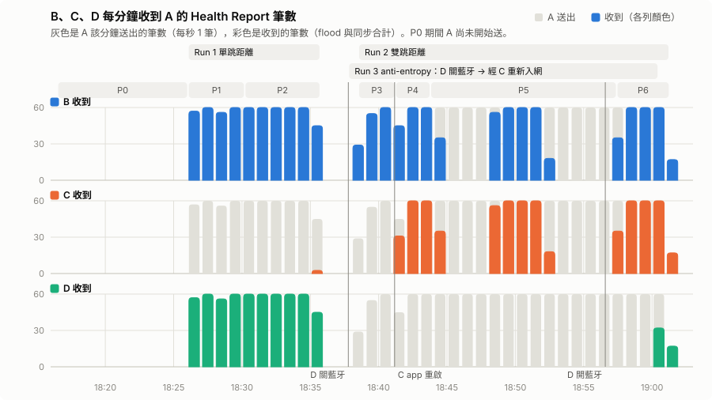
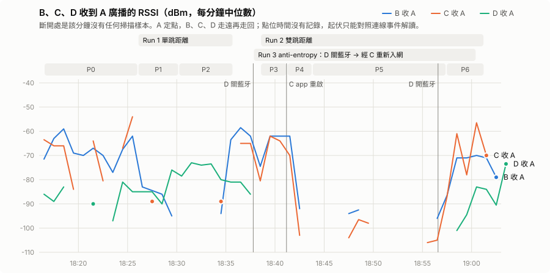

# 2026-11-18 四機實地試跑：單跳距離、雙跳、anti-entropy 與鄰居發現距離

- **原始資料**：`docs/experiment/raw/20261118_exp/`（含 peerID 與 serial，不進 repo）
- **派生資料與分析腳本**：同一資料夾的 `derived/`（見[附錄 B](#附錄-b派生檔案)）
- **代號**：本報告只用裝置代號 A–D；不屬於這四支的 peerID 以 X1、X2 表示
- **資料來源**：各機的 `exp.csv` 與 logcat，加上現場手寫紀錄（run 的目的與角色、三個距離值）

## 摘要

**實驗方式**：在空曠直線場地，A 定點不動，B、C、D 從 A 往外走，走到斷線後再走回來。共做了 4 個測試情境（run）。距離用 Google Maps 量測，誤差約 ±5 m。現場只記了三個距離值，沒有記錄每個點位的時間。

| Run | 測什麼 | 結果 |
|---|---|---|
| 1 | 單跳最大距離 | **d_max ≈ 170 m、d_rel ≈ 140 m**（A–B） |
| 2 | 雙跳距離 | B 在 A 的範圍邊緣當中繼時，B 收到 96.9%，C 經 B 收到同樣的 96.9%，B→C 這一跳完全沒掉；沒有量距離 |
| 3 | anti-entropy（用標準 Health Report） | 機制本身正常：重新連上後約 1 s，就由同步收到最新一筆。但 C 送的那筆最後沒有任何人收到；D 重開藍牙後花了將近 4 分鐘才重新入網 |
| 4 | 搜尋到鄰居的距離 | **約 15 m**。連線能撐到 170 m，重新連上卻要走回到 15 m，原因是 app 的連線 RSSI 門檻 |

### Run 1：單跳最大距離

- 現場以計數畫面判斷，得到 d_max ≈ 170 m、d_rel ≈ 140 m（A–B）。
- log 顯示，直連在斷線前 6 s 仍然逐筆收到，掉包只出現在斷線前最後約 10 s。斷線前最後看到的 RSSI 約 −93 ～ −95 dBm。
- 斷線之後 B 改由 D 轉送，所以 B 的現場計數畫面一直是滿格。**計數畫面分不出直連還是轉送**；正式的單跳測試應該把 TTL 設成 0。

### Run 4：搜尋到鄰居的距離

- 現場觀察約 15 m 才重新連上，與 d_max 170 m 相差約 155 m。
- 原因在程式：`BluetoothGattClientManager` 在掃描到的 RSSI 低於門檻時不會發起連線，BALANCED 模式的門檻是 −85 dBm；已經建立的連線則不受這個門檻限制。
- 資料完全吻合這個機制：重新連上之前，雙方已經以 −84 ～ −106 dBm 互相看到 38–131 s。4 次重連中有 3 次，是在第一筆 ≥ −85 dBm 的樣本出現後 1–2 s 內就連上。

### Run 3：anti-entropy

- **機制正常**：B 在 18:55:23 用 Health 畫面送出的那一筆，A 在與 B 重新連上後 1.1 s 收到，D 在與 C 連上後 1.2 s 收到，兩者都是同步送達。每位發送者只補最新一筆（B 前一筆 18:54:34 的就沒有再被同步）。
- **C 的那一筆遺失**：C 在 18:38:54 送出時，C 的連線已經失效，沒有任何節點收到；之後 C 的 app 重啟，同步暫存被清空，這筆再也補不回來。
- **D 重新入網太慢**：D 關藍牙時，app 沒有清掉與 A、B 的連線。重開藍牙後，連線表仍把 A、B 當成「已連線」，所以 D 掃到 A（最強 −67 dBm）、B 也不會發起連線。3 分 52 秒後，D 只與不在殘留清單裡的 C 連上，才重新入網；A–D、B–D 直到結束都沒有重建。

### 其他

- **延遲**：直連 p50 68 ms、p95 136 ms；2 跳 p50 118 ms、p95 566 ms。每多一跳，中位數約增加 50 ms。
- **C 的接收故障**：C 在 18:21–18:41 連線表上掛著直連，卻一筆都沒收到，所以 Run 1 完全沒有 C 的資料。
- **Flooding 成本**：每筆 Health Report 全網送出 2.41 次（C_tx），鏈路層寫出 4.81 次；每個節點平均每筆收到 1.6–3.1 份（R_dup）。沒有 QFULL。
- **方法上的修正**：[00 §3.2 (d)](../00-setup-and-instrumentation.md) 的同步判定規則會把 44 筆 flood 誤判成同步，需要補上「收到時 TTL = 0」的條件（見 [9.3](#93-flood-與同步的判定)）。

### 後續修改

扣掉實驗設計造成的漏收，剩下的漏收有 86% 來自 app 缺陷，鏈路本身只占 3.4%。修改依優先序整理在[第 13 節](#13-後續修改p0p1)，P0、P1 都已實作，做法與待驗證的項目見 [13.5](#135-實作狀態)：

| 優先 | 項目 |
|---|---|
| P0 | 藍牙關／開後的恢復、殭屍連線偵測、保存 Reporter 自己最新的回報 |
| P1 | SOS 與回報 2 小時後從網路上消失、連線門檻依情況調整、背景狀態下的連線與同步、讓「重要性」與 TTL 脫鉤 |

## 1. 實驗概要

| 項目 | 內容 |
|---|---|
| 日期與時間 | 2026-11-18 18:01–19:28（含時鐘偏移量測） |
| 場地 | 空曠直線場地（名稱未記錄）；天氣、Wi-Fi AP 數未記錄 |
| 量距方式 | Google Maps，誤差約 ±5 m |
| App commit | 未記錄 |
| 佈置 | A 定點；B、C、D 從 A 往外走到斷線，再走回 A |
| A 的發送器（Run 1、2） | Health Report，TTL 3，間隔 1000 ms，封包 101 bytes，18:26:03–19:01:16 共 1924 筆 |

| Run | 目的 | 對應的實驗計畫 | 時間 | 做法 |
|---|---|---|---|---|
| 1 | 單跳最大距離 | [E1-B](../01-multihop-line.md)（簡化：連續走遠、只量 A→B 一個方向） | 18:26:03–18:35:44 | A 送 578 筆；B 往外走到斷線，18:35:24 走回來重連 |
| 2 | 雙跳距離 | [E1-C](../01-multihop-line.md) 的雙跳部分 | 18:38:31–19:01:16 | A 送 1346 筆；B 當中繼，C 在 B 外側 |
| 3 | anti-entropy | [E5-D](../05-node-failure-and-mobility.md) | 18:37:47–19:00:28 | D 關藍牙；B、C 用 Health 畫面送標準 Health Report；D 開藍牙後重新入網 |
| 4 | 搜尋到鄰居的距離 | [E5-C](../05-node-failure-and-mobility.md) 的走入 | 18:35:24、18:48:04、18:57:25、18:57:45 的重連 | 從範圍外走回 A，看多近才重新連上 |

Run 2 與 Run 3 在時間上重疊：A 的發送器持續送出的同時，D 正在做關／開藍牙。

| 代號 | 型號 | Android | 電量（開始 → 結束） | 電池溫度 |
|---|---|---|---|---|
| A | Samsung SM-A3660 | 16 | 70% → 67% | 26.5–33.0 °C |
| B | vivo V2231 | 15 | 70% → 66% | 24.6–31.0 °C |
| C | OnePlus LE2100 | 16 | 99% → 95% | 25.2–32.3 °C |
| D | ASUS ROG Phone 9（ASUSAI2501B） | 16 | 32% → 27%（18:48），之後充電到 49%，結束時 43% | 26.0–34.3 °C |

A 的發送器有 5 次停頓：18:28:39（5 s）、18:35:44–18:38:31（Run 1 與 Run 2 之間）、18:39:09（5 s）、18:39:58（2 s）、18:41:33（16 s）。短的停頓看起來是發送器被重新啟動。

## 2. 資料完整性與控制變因

### 2.1 記錄與檔案

| 問題 | 影響 | 處理方式 |
|---|---|---|
| 手寫紀錄有 run 的目的、角色與三個距離值，但沒有點位時間（stations.csv）與 runs.csv | 無法把 log 對到公尺：RSSI 與距離的關係、路徑損耗指數 n、p_link(d) 都算不出來 | 距離只引用現場值；log 只用來檢查時間上的先後與成因 |
| 原始檔原本放在巢狀的 `20261118_exp/raw/20261118_exp/` | — | 已搬到 session 資料夾最上層（2026-11-18） |
| 資料夾名稱 `20261118_exp` 不是 `YYYY-MM-DD_場地` | 與其他 session 的命名不一致 | 未更名 |
| `offset_pre.csv` 同時含 session 前（18:01–18:12）與 session 後（19:07–19:27）的量測 | session 後的量測應寫進 `offset_post.csv` | 依時間間隔（> 30 分鐘）拆成前、後兩組 |
| devices.csv 缺藍牙版本、電池健康度、電池最佳化、peerID；models.csv 是空的 | peerID 改由各機 `TX` 列的 `src` 取得 | — |

### 2.2 控制變因的偏離

[00 §2](../00-setup-and-instrumentation.md) 要求距離類實驗固定在 BALANCED 模式。A 發送期間（18:26:03–19:01:17）各機的電源模式占比：

| 代號 | BALANCED | POWER_SAVER | PERFORMANCE | 原因（由 logcat 判斷） |
|---|---|---|---|---|
| A | 99.3% | 0.7% | — | 18:51:54 螢幕因逾時關閉（逾時設 10 分鐘），15 s 後被喚醒 |
| B | 99.7% | 0.3% | — | — |
| C | 59.4% | 40.6% | — | 螢幕逾時只設 60 s，反覆熄屏、進背景 |
| D | 69.5% | 1.0% | 29.5% | 18:50:52–19:01:16 接上充電（電量 27% → 44%） |

電源模式除了影響廣播發射功率，**也決定連線的 RSSI 門檻**：PERFORMANCE −95、BALANCED −85、POWER_SAVER −75 dBm（見第 8 節）。C 有四成時間在 POWER_SAVER，連線門檻比其他人嚴 10 dB。

其他偏離：

- **B 的前景服務沒有啟動**：logcat 記錄 `MeshForegroundService: Not starting service on API>=26 (shouldStartForeground=false)`，代表背景運作設定是關的，或權限不全。B 這次一直留在前景，對資料沒有直接影響。
- **D 的電量偏低**：開始時 32%，接近 [00 §2.1](../00-setup-and-instrumentation.md) 的 25% 暫停門檻；在 Run 3 藍牙關閉期間接上充電，重新入網時仍處於 PERFORMANCE（發射功率 HIGH，19:01:16 拔掉）。
- **B 的 2 則聊天訊息**不屬於任何 run，不影響下面的指標。
- **有兩個不屬於 A–D 的 peerID**：X1 在 session 開始前（18:06–18:15）與 C 連線；X2 只出現在一筆 17:20 的舊 Health Report，經同步在各機之間流傳。

## 3. 時鐘偏移

做法依 [00 §3.4](../00-setup-and-instrumentation.md)：捨棄 `t1 − t0 > 300 ms` 的樣本，取 `t1 − t0` 最小的 5 筆，offset 取中位數，不確定度取這 5 筆 `t1 − t0` 中位數的一半。offset = 手機時鐘 − 筆電時鐘。

| 代號 | session 前 | session 後 | 前後差 | 相對 A（前／後） | 採用值 |
|---|---|---|---|---|---|
| A | +843.0 ms ±108（18:06） | +551.5 ms ±100（19:07） | −291.5 | 0／0 | +697.2 |
| B | +858.0 ms ±94（18:12；10 筆有 1 筆 RTT 393 ms，捨棄） | +581.5 ms ±98（19:21） | −276.5 | +15／+30 | +719.8 |
| C | +804.0 ms ±89（18:01） | +531.0 ms ±88（19:24） | −273.0 | −39／−20.5 | +667.5 |
| D | −465.0 ms ±91（18:10） | −756.0 ms ±79（19:27） | −291.0 | −1308／−1307.5 | −610.5 |

- **前後差是筆電時鐘跳了一下，不是手機漂移**：四支的前後差都在 −273 ～ −292 ms，方向與大小幾乎相同，代表筆電的時鐘在 session 中途被校正了約 0.28 s。手機之間的相對偏移，前後只差 0.5–19 ms。
- **採用前後平均，不做線性內插**：延遲只用到「收端偏移 − 送端偏移」，筆電的共同跳動會互相抵消，所以每支直接取前後平均。四支的量測時刻不同，做線性內插反而會把筆電的跳動誤算成手機漂移。
- **延遲誤差**：依 00 §3.4 的保守算法是 ±80–110 ms。從相對偏移前後一致來看，實際誤差約 ±20 ms。所有路徑的延遲最小值都是正的（30–43 ms）。
- **D 一定要校正**：D 的時鐘比另外三支慢約 1.3 s，不校正的話，D 的延遲會變成約 −1.2 s。
- **同一支手機上的時間差不需要校正**：第 7、8 節的「連上 → 收到」「掃到 → 連上」都是同一支手機上兩個事件的時間差，不受偏移影響。

## 4. 時間軸

把 4 個 run 對到 log 上，再依連線狀態細分成 7 個階段。「有效鏈路」指雙方都記錄為連線中的時段，單方面殘留的連線不算。

| 階段 | Run | 時間 | A 送出 | 狀態 |
|---|---|---|---|---|
| P0 | — | 18:16:30–18:26:03 | — | 四機互連，A 還沒開始送；C 自 18:21 起收不到任何封包 |
| P1 | 1 | 18:26:03–18:30:12 | 245 | B 往外走，仍與 A 直連 |
| P2 | 1 | 18:30:12–18:35:44 | 332 | A–B 斷線（約 170 m），B 改經 D 收；18:35:24 B 走回來重連 |
| — | — | 18:35:44–18:38:31 | 0 | 兩個 run 之間。18:37:29 A、B、D 在同一秒斷開與 C 的連線；18:37:47 D 關藍牙（Run 3 開始） |
| P3 | 2、3 | 18:38:31–18:41:13 | 157 | 只剩 A–B 有效；C 仍收不到，D 的藍牙關閉 |
| P4 | 2、3 | 18:41:13–18:43:47 | 139 | C 的藍牙（18:40:51）與 app（18:41:10）重啟後，與 A、B 重新連線 |
| P5 | 2、3 | 18:43:47–18:57:25 | 818 | B 在 A 的範圍邊緣當中繼、C 在 B 外側：A–B 18:43:48 斷、18:48:04–18:52:26 連回；B 在 18:54:34、18:55:23 送標準 Health Report；D 在 18:56:35 開藍牙 |
| P6 | 2、3、4 | 18:57:25–19:01:17 | 232 | B、C 走回 A 而重連（18:57:25、18:57:45）；19:00:27 D 經 C 重新入網；B 在 19:01:27、19:01:40 再送兩筆 |

| 鏈路 | 有效連線區間 |
|---|---|
| A–B | 18:16:27–18:30:25、18:35:24–18:43:48、18:48:04–18:52:26、18:57:25 起 |
| A–C | 18:15:52–18:37:29、18:41:14–18:44:41、18:57:45 起 |
| A–D | 18:15:47–18:37:48 |
| B–C | 18:16:26–18:30:17、18:36:39–18:37:29、18:41:13 起 |
| B–D | 18:16:25–18:37:48 |
| C–D | 18:15:32–18:37:28、19:00:28–19:05:44 |

C 在 18:21–18:37 之間的連線，在事件上算有效，實際上沒有任何資料進來（見 [12.1](#121-c有連線但收不到封包18211841)）。



逐分鐘的數字在 `derived/timeline_per_minute.csv`。

## 5. Run 1：單跳最大距離

**現場結果**：d_max ≈ 170 m、d_rel ≈ 140 m（A–B，Google Maps ±5 m）。d_rel 是以現場計數畫面還收得到約 95% 以上為準。

**log 的對照**：

B 直接從 A 收到的副本（`RX` 或 `DUP`，上一跳是 A），以 A 送出的時間每 10 s 統計：

| 時段 | 18:29:00 起的 6 段（每段 10 s） | 18:30:00–18:30:10 | 18:30:10 之後 |
|---|---|---|---|
| 直連收到／送出 | 每段 10/10 | 7/10 | 0 |

- **直連幾乎是一斷就斷**：最後一筆直連副本是 18:30:06 送出的，B 在 18:30:12 記錄 `LINK_DOWN`，A 則在 18:30:17。直連從「每筆都收到」到斷線，中間只有約 10 s 的掉包。由於沒有點位時間，無法確認 140 m 對應到哪一刻；以步行速度約 1 m/s 估算，這 10 s 約是最後 10 m。
- **斷線前的 RSSI**：B 收 A 最後一筆是 −95 dBm，A 收 B 最後一筆是 −93 dBm。但這兩筆都是在斷線前 70 s 左右掃到的，之後就掃不到對方的廣播，連線卻還維持著（見 [10.4](#104-連線事件前後的-rssi)）。
- **斷線後 B 由 D 轉送**：D 位於 A 與 B 之間，仍在兩者的範圍內（D 收 A 約 −77 dBm、D 收 B 約 −97 dBm）。18:30:12 之後，B 收到的每一筆都是經 D 轉送的 2 跳。因此整個 Run 1，B 收到 577/577 筆，其中 342 筆經 D。
- **計數畫面分不出直連與轉送**：B 的現場計數畫面在 18:30 之後仍然是滿格，所以這段時間它反映的不是單跳鏈路。正式的單跳測試（E1-B）應把發送器的 TTL 設成 0（只到直連鄰居），或讓其他手機遠離。

| 接收端 | Run 1 收到 | 說明 |
|---|---|---|
| B | 577/577（100%；Wilson 下界 99.3%） | 直連 235 筆，經 D 342 筆 |
| C | 0/577 | C 的接收故障（第 12 節） |
| D | 577/577（100%；Wilson 下界 99.3%） | 全部直連；可作為近距離的單鏈路送達率 |

## 6. Run 2：雙跳距離

B 當中繼，站在 A 的範圍邊緣；C 站在 B 外側。B–C 從 18:41:13 起一直保持連線。現場沒有量 B、C 的位置，**雙跳距離算不出來**；從 A–B 鏈路在邊緣反覆斷線（A 收 B −84 ～ −100 dBm）來看，B 大約在 d_max 附近。

| 時段 | A 送出 | B 收到 | C 收到 | 說明 |
|---|---|---|---|---|
| P4 18:41:13–18:43:47 | 139 | 139（直連 111） | 138（直連 125、經 B 13） | 剛重連，三機都在範圍內 |
| A–B 連線中 18:48:04–18:52:26 | 262 | 254（96.9%，全部直連） | 254（96.9%，全部經 B） | **典型的雙跳狀態** |
| P5 全段 18:43:47–18:57:25 | 818 | 302（36.9%） | 302（36.9%） | A 有 498 筆送出時沒有任何鏈路；只看 A 有鏈路的 320 筆是 94.4%（91.3–96.4） |
| P6 18:57:25–19:01:17 | 232 | 232 | 232 | 走回 A |

- **雙跳的損失都在第一跳**：A–B 連線期間，C 收到的正好就是 B 收到的那 254 筆，B→C 這一跳一筆都沒掉，掉的 8 筆都在 A–B 這一跳（B 在範圍邊緣）。
- **雙跳延遲**（A→B→C，這段時間）：p50 119 ms、p95 342 ms。
- **A 孤立時送出的 498 筆**：B 在範圍外，這 498 筆沒有任何人收到，事後也沒有補送。這是同步只保留最新一筆的設計（見 7.2）。

## 7. Run 3：anti-entropy

### 7.1 標準 Health Report 的去向

這個 run 用 Health 畫面送出標準 Health Report（TTL 3），不用實驗發送器。

| 發送者 | 送出時間 | 當下狀況 | 誰收到、怎麼收到 |
|---|---|---|---|
| C | 18:38:54 | C 的舊連線已經失效（12.1），D 的藍牙關閉 | **沒有任何節點收到**。C 的 app 在 18:41 重啟後，同步暫存是空的，之後也沒有任何 `SYNC` 帶出這一筆 |
| B | 18:54:34 | A 不在 B 的範圍；D 的藍牙關閉 | C 經 flood 收到。49 s 後被 B 的下一筆取代，不再同步 |
| B | 18:55:23 | 同上 | C 立即經 flood 收到。A 在 18:57:26 經 B 同步收到（A–B 重連後 1.1 s，收到時 TTL 0）。D 在 19:00:28 經 C 同步收到（C–D 連上後 1.2 s，TTL 0） |
| B | 19:01:27 | D 已重新入網（正向對照） | A、C 直連收到；D 經 C 收到（2 跳） |
| B | 19:01:40 | 同上 | 同上 |

- **同步本身運作正常**：符合 E5-D 的預期，「`LINK_UP` → `RX`」只要約 1 s（連上 1 s 後發出同步請求）。D 的 `RX` 記錄在驗簽之後，代表 D 關閉藍牙 19 分鐘後，仍然驗得過 B 的簽章。
- **每位發送者只補最新一筆**：B 的 18:54:34 那筆沒有再被同步出去，這是 Health Report 只保留最新狀態的設計。
- **C 的遺失是一個缺口**：Reporter 在連線失效時送出 Health Report，之後 app 又重啟，這筆回報就永遠不會到達任何人，除非使用者自己再送一次。可能的改法：持久保存自己最新的一筆，app 重啟或建立新連線時重新提供給同步。

### 7.2 D 重新入網的過程

| 時間 | 事件 |
|---|---|
| 18:37:28 | D 記錄 `LINK_DOWN C`（C 的接收故障造成，見 12.1）。這是 D 關藍牙前最後一次正常斷線 |
| 18:37:47 | D 關閉藍牙。A、B 在同一秒記錄 `LINK_DOWN D` |
| 18:37:52 起 | D 的 app 沒有記錄與 A、B 的 `LINK_DOWN`，`STAT` 一直列出 A、A、B、B 四條連線；app 持續呼叫失效的藍牙 binder，記了約 40 萬行 `Too many transaction errors`（D 的 logcat 因此達 468 MB） |
| 18:50:52 | D 接上充電，切到 PERFORMANCE（發起連線的門檻 −95 dBm） |
| 18:56:35 | 從快速設定重新打開藍牙（`Tile.BluetoothTile: CLICK`） |
| 18:56:34–19:05:44 | app 對殘留連線的舊 GATT 物件寫入，每次都失敗：約 13.3 萬行 `BLE SERVER_NOTIFICATION／CLIENT_WRITE failed to start: DeadObjectException` |
| 18:58:30 起 | D 恢復掃描。A 從 18:59:08、B 從 18:59:35 起高於門檻 −95 dBm（A 最強 −67、B 最強 −75 dBm；高於門檻的樣本，A 有 79 筆、B 有 69 筆），D 卻一直沒有連上 A、B |
| 19:00:27 | D 與 C 連上（藍牙開啟後 3 分 52 秒）。1.2 s 後 D 經同步收到 B 的最新一筆，之後 A 的封包也經 C 轉送進來（入網後 49/50） |
| 19:01:30–19:01:51 | A、B、C 才第一次掃到 D 的廣播：D 開藍牙後約 5 分鐘，別人都掃不到它 |
| 19:05:44 | D 才清掉 A、B 的殘留連線；A–D、B–D 到結束都沒有重建 |

**D 連不回 A、B 的原因**：`BluetoothGattClientManager` 處理掃描結果時，若 `connectionTracker.isPeerConnected(peerID)` 為真就直接 return，不發起連線。這個判斷依 peerID 查連線表，而 D 的連線表裡一直留著 A、B 的舊連線。所以不論 A、B 的訊號多強，D 都把它們當成已經連上而跳過。C 的連線在關藍牙前已正常斷開（18:37:28），不在殘留清單裡，因此只有 C 連得上。另一方面，D 的廣播約 5 分鐘沒有被任何人掃到，A、B 也無法主動來連 D。

D 關閉藍牙是實驗設計，但 app 沒有處理「藍牙關閉後再打開」：殘留連線沒有清掉，反而擋住了重連；重開後仍寫入舊物件；廣播也沒有及時恢復。

### 7.3 資訊新鮮度

Health Report 是「最新狀態」，不是逐筆累積的紀錄，所以除了 PDR，也要看接收端手上的資訊有多舊。

資訊年齡（Age of Information）的算法：每秒取樣一次，看接收端手上 A 最新的那一筆 Health Report 已經是多久以前的（以 A 的時鐘計）。

| 階段 | B：中位數／p95 | C：中位數／p95 | D：中位數／p95 |
|---|---|---|---|
| P1 | 0.3／0.3 s | 一筆都還沒收到 | 0.3／0.3 s |
| P2 | 0.3／1.3 s | 一筆都還沒收到 | 0.3／0.3 s |
| P3 | 0.8／0.9 s | 246／319 s | 246／319 s |
| P4 | 0.5／8.8 s | 0.5／10.8 s | 404／474 s |
| P5 | 53.5／266.5 s | 53.5／266.5 s | 890／1259 s |
| P6 | 0.5／0.5 s | 0.5／0.5 s | 1367／1472 s（大部分時間尚未入網） |

各接收端最長的中斷：B 308 s（18:52:17–18:57:25）、C 330 s（18:35:44–18:41:14）、D 1484 s（18:35:44–19:00:28）。

- 對 A 的 1 Hz 串流來說，同步幾乎都是多餘的：A、B、C、D 對 A 的 Health Report 一共發出 105 次 `SYNC`，只有 1 次是對方第一次收到。重連後，下一筆 flood 不到 1 s 就到了。
- 要量同步的效果，必須像 Run 3 那樣只送一筆，不能用連續發送。

## 8. Run 4：搜尋到鄰居的距離與遲滯

**現場結果**：從範圍外走回 A，約 **15 m** 才重新連上。斷線發生在約 170 m，連上卻要 15 m，遲滯（hysteresis）約 155 m。[E5-C](../05-node-failure-and-mobility.md) 本來就預期會有遲滯，但這次的差距遠大於直覺。

**原因：app 的連線 RSSI 門檻**。`BluetoothGattClientManager` 每次掃到鄰居時，若 RSSI 低於 `PowerManager.getRSSIThreshold()`，就不發起連線。已經建立的連線不受這個門檻限制，會一直撐到 BLE supervision timeout。

| 電源模式 | 發起連線的 RSSI 門檻 |
|---|---|
| PERFORMANCE | −95 dBm |
| BALANCED | −85 dBm |
| POWER_SAVER | −75 dBm |
| ULTRA_LOW_POWER | −65 dBm |

**資料的對照**：走回 A 時，雙方早就互相掃到對方，只是 RSSI 沒有達到門檻。

| 重連 | 第一次掃到 → 連上 | 這段期間的 RSSI | 連上前最後一筆 |
|---|---|---|---|
| A–B 18:35:24 | 131 s | −89 ～ −99 dBm | B 收 A −89（18:35:20）；沒有 ≥ −85 的紀錄 * |
| A–B 18:48:04 | 58 s | −84 ～ −100 dBm | A 收 B **−84**（18:48:03） |
| A–B 18:57:25 | 38 s | −85 ～ −100 dBm | A 收 B **−85**（18:57:23） |
| A–C 18:57:45 | — ** | −85 ～ −106 dBm | C 收 A **−85**（18:57:44、18:57:45） |

\* exp.csv 每個鄰居每秒最多只記一筆 `RSSI`，觸發連線的那一筆可能沒有被記下來。<br>
\** C 在 18:47–18:49 曾零星掃到 A，不是這次走回的一部分。

- **門檻機制吻合**：4 次中有 3 次，第一筆 ≥ −85 dBm 的樣本出現後 1–2 s 內就連上。
- **廣播的可見範圍遠大於 15 m**：在 −89 ～ −106 dBm 時就已經掃得到對方，只是 app 不連。所以「搜尋到鄰居」其實有兩個距離：掃得到廣播的距離（遠）與發起連線的距離（約 15 m）。
- **背景時更近**：POWER_SAVER（app 在背景）的門檻是 −75 dBm，要走得比 15 m 更近才連得上。
- **對實地使用的意義**：救援者要走到約 15 m 內才會與受困者的手機建立連線；一旦連上，走遠到 170 m 都還能維持。
- **對模擬器的意義**：鏈路模型需要兩個門檻，「建立連線」用 −85 dBm，「維持連線」直到約 −95 ～ −100 dBm。不能用同一個距離同時代表兩者。
- **對產品的取捨**：門檻設高，可以避免連到品質差的鄰居、佔用連線名額；但在災區，晚 155 m 才連上的代價可能更高。建議評估 BALANCED 下放寬到接近 −95 dBm，或對近期見過的 peer 放寬門檻（見 [P1-5](#p1-5-連線門檻依情況調整)）。

## 9. 整場的送達率（PDR）

以 `(src, pts)` 對齊 A 的 `TX`（type 0x30）與 B、C、D 的 `RX`。信賴區間為 Wilson 95%。

### 9.1 整體

| 接收端 | 收到／送出 | PDR | A 至少有一條鏈路時（fanout ≥ 1） |
|---|---|---|---|
| B | 1408/1924 | 73.2%（71.2–75.1） | 1408/1426 = 98.7%（98.0–99.2） |
| C | 673/1924 | 35.0%（32.9–37.1） | 673/1426 = 47.2%（44.6–49.8） |
| D | 627/1924 | 32.6%（30.5–34.7） | 627/1426 = 44.0%（41.4–46.6） |

- 整體數字混合了 4 個 run 的設計（走出範圍、D 關藍牙）與 C 的接收故障，**不代表鏈路品質**；各 run 的結果見第 5–8 節。
- 只有 C 有 1 筆是同步送達，其餘全部是 flood。
- 至少一個接收端收到的有 1408 筆，剛好就是 B 收到的那些：C、D 收到的每一筆，B 都有收到。

### 9.2 依階段

| 階段 | 送出 | B | C | D |
|---|---|---|---|---|
| P1 | 245 | 245（100%；98.5–100） | 0 | 245（100%；98.5–100） |
| P2 | 332 | 332（100%；98.9–100） | 0 | 332（100%；98.9–100） |
| P3 | 157 | 157（100%；97.6–100） | 0 | 0（藍牙關閉） |
| P4 | 139 | 139（100%；97.3–100） | 138（99.3%；96.0–99.9） | 0（藍牙關閉） |
| P5 | 818（498 筆送出時無鏈路） | 302（36.9%） | 302（36.9%） | 0（藍牙關閉） |
| P6 | 232 | 232（100%；98.4–100） | 232（100%；98.4–100） | 49（21.1%）；19:00:27 入網後 49/50 |

### 9.3 flood 與同步的判定

[00 §3.2 (d)](../00-setup-and-instrumentation.md) 的規則是：接收端 Q 的一筆 `RX`，若上一跳 P 的 exp.csv 有同一個 `(src, pts)`、`peer` = Q 的 `SYNC` 列，就算同步送達。照這條規則，A 的串流中有 45 筆會被判成同步。

但同步回送一律用 `SYNC_TTL_HOPS = 0` 送出（`GossipSyncManager.handleRequestSync`），所以同步送來的副本，收到時 TTL 一定是 0。這 45 筆中有 44 筆收到時 TTL 是 2 或 3，只可能是 flood 副本：上一跳剛好也對同一個封包回了 SYNC，但 Q 先從 flood 收到了。

本報告改用「收到時 TTL = 0，**而且**上一跳有對應的 `SYNC` 列」作為判定，A 的串流中真正的同步送達只有 1 筆。Run 3 的兩筆同步送達（A、D 收到 B 的 18:55:23），收到時 TTL 都是 0，符合這個判定。這次 flood 最多 3 跳，到不了 TTL 0，所以這個判定不會漏算。建議把這個條件補進 00 §3.2 (d)。

## 10. RSSI

`RSSI` 事件是掃描到的鄰居廣播強度，每個鄰居每秒最多一筆。「P 收 Q」是 P 的 exp.csv 中 `peer` = Q 的列。沒有點位時間，下面的數字只描述這場的實際狀況，不是 RSSI 與距離的關係。

### 10.1 各方向的整體分布

| 收端 ← 送端 | 樣本數 | 中位數 (dBm) | p10 | p90 |
|---|---|---|---|---|
| A ← B | 645 | −71 | −93 | −58 |
| A ← C | 241 | −80 | −94 | −67 |
| A ← D | 303 | −80 | −92 | −70 |
| B ← A | 501 | −70 | −92 | −58 |
| B ← C | 399 | −86 | −95 | −65 |
| B ← D | 145 | −86 | −95 | −73 |
| C ← A | 288 | −70 | −97 | −58 |
| C ← B | 658 | −78 | −97 | −55 |
| C ← D | 122 | −87.5 | −100 | −77 |
| D ← A | 432 | −83 | −97 | −71 |
| D ← B | 319 | −90 | −100 | −75 |
| D ← C | 71 | −95 | −101 | −84 |



### 10.2 P0（四機同處、A 尚未發送）的 RSSI 矩陣

列是收端，欄是送端；數值為中位數 (dBm)。手機的擺放位置沒有記錄。

| 收端 \ 送端 | A | B | C | D |
|---|---|---|---|---|
| A | — | −65 | −74 | −86.5 |
| B | −67 | — | −84 | −87 |
| C | −64 | −73 | — | −90 |
| D | −85 | −90.5 | −95 | — |

D 和每一支之間都在 −85 dBm 以下，可能是 D 擺得比較遠，也可能是 D 的天線比較弱，無法分辨。

### 10.3 裝置的收發不對稱

藍牙鏈路的路徑損耗是雙向對稱的，因此同一分鐘內「P 收 Q − Q 收 P」只剩下兩支手機的裝置差異：

RSSI(P 收 Q) − RSSI(Q 收 P) = g_Q − g_P，其中 g = 發射強度 − 接收增益

先取兩個方向在同一分鐘內的中位數相減，再對所有分鐘取中位數，最後以共同分鐘數加權做最小平方解（固定 g_A = 0）。

| 配對 | 共同分鐘數 | P 收 Q − Q 收 P (dB) |
|---|---|---|
| A–B | 31 | +1.0 |
| A–C | 22 | −11.0 |
| A–D | 23 | +0.5 |
| B–C | 30 | −8.25 |
| B–D | 16 | +0.75 |
| C–D | 6 | +7.0 |

結果：g_B = −0.1 dB、g_C = −9.2 dB、g_D = +0.2 dB（相對 A），各配對的殘差 ≤ 2.4 dB。

C 的「發射 − 接收」比另外三支低約 9 dB：可能是 C 的廣播比較弱，也可能是 C 的接收比較靈敏，或兩者都有。要分開這兩者，得照 E1-A 在固定距離對參考機量。不論哪一種，C 的鏈路都不對稱：C 聽得到別人，別人比較難聽到 C。再加上第 8 節的連線門檻，C 的鄰居要比平常更近才會主動連上 C。

### 10.4 連線事件前後的 RSSI

- **建立連線時**（`LINK_UP` 列的 rssi）的中位數：A–B −84.5、A–C −80、A–D −78、B–C −76、B–D −79、C–D −91 dBm。這一欄記的是「最近 60 s 內最新的一筆」，不一定就是觸發連線的那一筆，所以會出現低於 −85 的值。
- **因距離拉開而斷線**的 4 次（都在 Run 1、Run 2）：

| 斷線時間 | 鏈路 | 最後一次看到對方廣播的 RSSI | 最後一次掃到距離斷線 |
|---|---|---|---|
| 18:30:12–18:30:29 | A–B | B 收 A −95；A 收 B −93 | 70–83 s |
| 18:43:42–18:43:49 | A–B | B 收 A −83；A 收 B −99 | 61–98 s |
| 18:44:41–18:44:45 | A–C | C 收 A −107；A 收 C −92 | 124–173 s |
| 18:52:26 | A–B | B 收 A −94；A 收 B −99 | 186–207 s |

18:37 那幾次斷線是 C 的故障與 D 關藍牙造成的，不列入。

**掃不到對方的廣播，不等於斷線。** 連線在掃不到廣播之後，還維持了 1–3.5 分鐘。連線靠 supervision timeout 判斷存活，可以撐到比廣播可見範圍更遠的地方。這與第 8 節合起來，構成三個距離：

| 距離 | 本次的值 |
|---|---|
| 發起連線（RSSI ≥ −85 dBm） | 約 15 m |
| 掃得到廣播 | 更遠，但沒有點位時間，無法換算成公尺 |
| 連線維持（d_max） | 約 170 m |

## 11. 延遲、跳數與 flooding 成本

### 11.1 延遲與跳數

延遲 L = (t_RX − off_收) − (pts − off_A)；跳數 h = 3 − TTL_收 + 1。下表只計 A 串流的 flood。

| 路徑 | 跳數 | 筆數 | p50 (ms) | p95 (ms) | 最大 (ms) |
|---|---|---|---|---|---|
| A→B | 1 | 988 | 64 | 144 | 1148 |
| A→C | 1 | 379 | 69 | 308 | 2430 |
| A→D | 1 | 578 | 74 | 94 | 117 |
| A→D→B | 2 | 342 | 118 | 1020 | 3728 |
| A→C→B | 2 | 78 | 146 | 1822 | 2460 |
| A→B→C | 2 | 293 | 116 | 306 | 1174 |
| A→C→D | 2 | 47 | 116 | 139 | 152 |
| A→B→C→D | 3 | 2 | 110 | — | 148 |
| **全部 1 跳** | 1 | 1945 | 68 | 136 | 2430 |
| **全部 2 跳** | 2 | 760 | 118 | 566 | 3728 |

（A→C 有 2 筆的上一跳欄位是空的，TTL 為 3，算作直連。）

- **每跳延遲 ΔL**：
  - 以中位數計，每多一跳 +50 ms（68 → 118 ms）。
  - 對所有樣本做線性迴歸，斜率是 118 ms，但被 2 跳的長尾拉高：2 跳的 p95 是中位數的 4.8 倍。
  - 建議以中位數差 50 ms 為主，並附上分布。
- **長尾**：超過 1 s 的，1 跳有 7 筆（0.4%），2 跳有 25 筆（3.3%）。2 跳的長尾集中在 Run 1 的 A→D→B：B 在 170 m 外，B–D 之間的 RSSI 約 −88 ～ −97 dBm，推測是鏈路在邊緣時的重傳。
- **TTL 上限沒有測到**：TTL 3 最遠可到第 4 跳，但 4 支手機最多只能形成 3 跳。

### 11.2 Flooding 成本與佇列

以下只計 A 的 1924 筆 Health Report。

| 節點 | RX | DUP | R_dup = (RX + DUP) / RX | RELAY | RELAY 寫出的鏈路數 |
|---|---|---|---|---|---|
| A（來源） | — | — | — | TX 1924 | 4381 |
| B | 1408 | 1813 | 2.29 | 1408 | 2141 |
| C | 673 | 1388 | 3.06 | 672 | 1099 |
| D | 627 | 379 | 1.60 | 627 | 1641 |

- **傳輸成本**：C_tx = (1924 + 2707) / 1924 = **2.41**。乘上 fanout，鏈路層一共寫出 9262 次，等於每筆 4.81 次。
- **每一筆都會被轉發**：B、C、D 對收到的每一筆都轉發，C 只少 1 筆（同步送來的那筆 TTL 為 0，不再轉發）。這符合 networkSize ≤ 10 時 relay 機率為 1.0 的預期。
- **轉發時沒有其他鏈路可送**：B 有 342 次 `RELAY` 的 fanout 是 0，都發生在 Run 1 斷線後。B 只剩 D 一條鏈路，封包本來就從 D 來，沒有別的鏈路可以轉。
- **QFULL**：四支都是 0。每秒 1 筆遠低於飽和點。
- **重複交付**：A 的 1924 筆，在任何節點都沒有出現兩次 `RX`。另外，X2 那筆 17:20 的舊 Health Report 在 C 出現了 3 次 `RX`（18:06、18:41、19:24）。18:41 那次是 app 重啟、去重表清空之後，屬於預期行為；19:24 那次的原因未查。
- **直連數 `n_links` 不等於鄰居數**：`n_links` 的最大值是 A、B、D 6 條、C 5 條，但不重複的鄰居最多只有 3 個。原因是同一對手機常同時有 GATT client 與 server 兩條連線，`n_links` 兩條都算。程式設定的連線上限 8 沒有碰到。

## 12. 異常事件與根因

### 12.1 C：有連線，但收不到封包（18:21–18:41）

這不屬於任何 run 的設計，C 因此錯過了整個 Run 1 與 Run 2 的開頭。

證據：

- **有連線、零收包**：18:21 起，C 的 `RX`、`DUP` 都是 0，但 `STAT` 仍列出 A、B、D 三條直連。C 照常送出 REQUEST_SYNC，也掃得到 RSSI。
- **CPU 有在休眠**：這段期間 C 有一半以上的時間在 POWER_SAVER（螢幕逾時 60 s）。`STAT` 應該每 60 s 一筆，實際間隔 1–5 分鐘不等，表示計時器被延後了。kernel log 在 18:34–18:35 也有反覆進入系統休眠的紀錄。
- **新連線有資料，舊連線沒有**：18:36:39 B 與 C 建立一條**新**連線後，C 馬上從 B 收到封包（每分鐘 15 筆），舊的 A、D 連線仍然沒有任何資料。
- **對方都斷了，C 自己沒記到**：18:37:29，A、B、D 在同一秒斷開與 C 的連線，但 C 自己到 18:41:05 才記錄 `LINK_DOWN`。
- **重啟後立刻恢復**：18:40:51 C 的系統藍牙程序結束，18:41:10 app 程序結束（狀態為 cached），18:41:11 app 重新啟動。2–3 s 內與 A、B 重新連上，之後接收正常（P4 99.3%）。
- **連帶影響**：C 在 18:38:54 送出的標準 Health Report 因此遺失（7.1）。

根因還無法確定：C 的 logcat main buffer 從 18:34:43 才開始，沒有涵蓋問題開始的時刻。推測與熄屏後系統休眠有關。

### 12.2 D：關閉再打開藍牙後，app 沒有恢復

D 關閉藍牙是 Run 3 的設計，但 app 的反應有問題（時間軸見 7.2）：

- **藍牙關閉時，連線表沒有清掉**：A、A、B、B 四條殘留連線留了 28 分鐘。
- **殘留連線擋住重連**：`isPeerConnected` 依 peerID 查到殘留項目，D 就跳過 A、B 的掃描結果，即使 A 達 −67 dBm。
- **持續呼叫失效的藍牙 binder**：約 40 萬行錯誤 log。
- **藍牙打開後，仍寫入舊的 GATT 物件**：約 13.3 萬次 `DeadObjectException`。
- **藍牙打開後，廣播約 5 分鐘沒有被掃到**：別人也無法主動來連。
- 最後只與 C 連上（C 不在殘留清單裡），D 才回到網路；A–D、B–D 一直沒有重建。

這兩件事的修改方向，連同其他後續修改，依優先序整理在[第 13 節](#13-後續修改p0p1)。

## 13. 後續修改：P0、P1

以下依「對災區場景的影響 × 改動成本」排序。13.1～13.4 保留試跑當時的分析與建議；實際的做法、與建議不同之處，以及尚待驗證的項目，見 [13.5](#135-實作狀態)。

CARES Mesh 的使用場景：
- 災區的手機稀疏，多半熄屏或放在口袋裡，電量有限。
- 使用者會關藍牙、手機會重開。
- Rescuer 往往是之後才走進範圍的人，而且常常只是從旁邊經過。

### 13.1 排序依據：漏收歸因

3 個接收端 × A 的 1924 筆，共 5772 筆應收，其中 3064 筆沒收到。逐筆依當時的狀態歸到一個原因。原因重疊時，先歸給 D、C 自身的狀態，再看 A 當時有沒有鏈路；例如 D 關藍牙期間 A 也孤立，算在 D 關藍牙。

| 原因 | 類型 | 漏收筆數 | 占漏收 | 判定方式 |
|---|---|---|---|---|
| D 關藍牙 | 設計（Run 3） | 1064 | 34.7% | 收端 D，A 送出時間在 18:37:47–18:56:35 |
| A 不在任何人範圍內 | 設計（Run 2） | 878 | 28.7% | A 送出時沒有任何鏈路（fanout 0），且不在下面「連線門檻」的時段 |
| C 殭屍連線 | app 缺陷 | 734 | 24.0% | 收端 C，A 送出時間早於 18:41:13 |
| D 開藍牙後，掃描與廣播未恢復 | app 缺陷 | 153 | 5.0% | 收端 D，18:56:35–18:59:08 |
| 已看得到 A，但 RSSI < −85 dBm 不連 | 連線門檻 | 118 | 3.9% | 收端 B、C，重連前雙方已以 ≥ −95 dBm 互相掃到的時段（18:47:43–18:48:04、18:56:47–18:57:25） |
| D 殘留連線擋住重連 | app 缺陷 | 79 | 2.6% | 收端 D，18:59:08（D 第一次以 ≥ −95 dBm 掃到 A）至 19:00:27 |
| 範圍邊緣掉包等 | 鏈路 | 38 | 1.2% | 其餘 |

扣掉設計造成的 1942 筆，剩下的 1122 筆漏收中：

| 類型 | 漏收筆數 | 占比 |
|---|---|---|
| app 缺陷 | 966 | 86% |
| 連線門檻 | 118 | 10.5% |
| 鏈路本身 | 38 | 3.4% |

鏈路本身很可靠，所以先修 app 的連線管理（P0），再調整策略（P1）：

- **P0**：會讓回報「看似送出、其實沒人收到」的缺陷。改法明確，不需要新實驗，也不改協定，不影響與 iOS 的相容性。
- **P1**：決定 Rescuer 能不能及時看到回報的策略。需要先決策（建議寫 ADR），或先用實驗驗證。

下面各項的「本次可救回」是反事實估計：假設修正後，該接收端的表現與同一時段正常運作的 B、D 相同，因此是上限。

### 13.2 P0：會讓回報「看似送出、其實沒人收到」的缺陷

#### P0-1 藍牙關閉、重新開啟後的恢復

- **問題**（7.2、12.2）：
  - D 關藍牙時，app 沒有記錄 `LINK_DOWN`，A、B 的殘留連線留了 28 分鐘。
  - 重開後，`BluetoothGattClientManager` 處理掃描結果時，`isPeerConnected` 依 peerID 查到殘留項目就直接跳過，所以 D 掃到 A（−67 dBm）也不連。
  - app 繼續寫入舊的 GATT 物件，失敗約 13.3 萬次；廣播約 5 分鐘沒被任何人掃到。
  - 最後只靠 C 連上，3 分 52 秒才重新入網；A–D、B–D 一直沒有重建。
- **修改方向**：監聽 `BluetoothAdapter.ACTION_STATE_CHANGED`。關閉時清空 `BluetoothConnectionTracker`、停止寫入；開啟時重建 GATT server／client、掃描與廣播。GATT 呼叫拋出 `DeadObjectException` 時，視同藍牙已經重啟，走同一套流程。
- **場景理由**：使用者會為了省電關藍牙，手機會重開，系統藍牙程序也可能崩潰。手機若無法自己回到網路，就只能等別人來連。
- **本次可救回**：最多 232 筆（153 + 79）；重新入網從 3 分 52 秒縮短到數秒（待驗證）。
- **相關程式**：[BluetoothConnectionTracker.kt](../../../app/src/main/java/com/bitchat/android/mesh/BluetoothConnectionTracker.kt)、[BluetoothGattClientManager.kt](../../../app/src/main/java/com/bitchat/android/mesh/BluetoothGattClientManager.kt)、[BluetoothMeshService.kt](../../../app/src/main/java/com/bitchat/android/mesh/BluetoothMeshService.kt)
- **驗證**：E5-D 加上藍牙關／開。重開後應在數秒內重新入網，並與 A、B 重建連線。

#### P0-2 殭屍連線偵測

- **問題**（12.1）：
  - C 在 18:21–18:41 掛著 2–3 條連線，卻一筆都沒收到。
  - 18:36:39 B 與 C 建立一條新連線後，C 馬上就從 B 收到資料。
  - 18:37:29 A、B、D 在同一秒斷開與 C 的連線，C 自己到 18:41:05 才記錄 `LINK_DOWN`。
- **修改方向**：每條鏈路記錄最後一次收到封包的時間，超過門檻就斷開重連。門檻要大於鄰居的心跳間隔，才不會誤殺安靜但正常的連線，建議約 90 s：
  - 鄰居每 30 s 送一次同步請求，對方休眠時會拉長到約 60 s。
  - 背景時 ANNOUNCE 間隔是 60–300 s。
- **場景理由**：連線表看起來正常，使用者與鄰居都察覺不到異常，比沒有連線更危險。
- **本次可救回**：734 筆（C 在 Run 1 的全部），是非設計漏收中最大的一項。
- **待查**：C 一開始為什麼收不到。當時 C 的 logcat 沒有涵蓋問題開始的時刻；推測與熄屏後系統休眠有關，建議補記這類事件。
- **相關程式**：[BluetoothConnectionTracker.kt](../../../app/src/main/java/com/bitchat/android/mesh/BluetoothConnectionTracker.kt)、[BluetoothMeshService.kt](../../../app/src/main/java/com/bitchat/android/mesh/BluetoothMeshService.kt)
- **驗證**：E5-D 確認能恢復；E4 確認熄屏、背景時安靜的連線不會被誤判。

#### P0-3 保存 Reporter 自己最新的 Health Report

- **問題**（7.1）：
  - C 在 18:38:54 送出的標準 Health Report，送出時連線已經失效，沒有任何節點收到。
  - 18:41 app 重啟後，同步暫存是空的，之後也沒有任何 `SYNC` 帶出這一筆。
  - 同步只能補「有人持有」的回報：持有者自己丟了，就沒有人能補。
- **修改方向**：持久保存自己最新一筆已簽章的 Health Report，app 重啟後放回 `GossipSyncManager`，讓之後連上的鄰居在同步時補到。
- **注意**：放回的是同一筆封包，到期時間不變，仍是從原始時間戳起算 2 小時（見 P1-4）。
- **本次可救回**：C 遺失的那 1 筆回報。
- **相關程式**：[GossipSyncManager.kt](../../../app/src/main/java/com/bitchat/android/sync/GossipSyncManager.kt)、[BitchatFlutterChannels.kt](../../../app/src/main/java/com/bitchat/android/flutter/BitchatFlutterChannels.kt)（`sendHealthReport`）
- **驗證**：送出回報 → 強制結束 app → 重啟；之後才連上的鄰居應經同步收到這一筆。

### 13.3 P1：決定 Rescuer 能不能及時看到回報的策略

#### P1-4 SOS 與回報在 2 小時後從網路上消失

- **機制**：
  - 每筆 Health Report 在同步暫存中保留 2 小時（`AppConstants.Sync.HEALTH_REPORT_RETENTION_MS`）。年齡 = 本機時鐘 − 封包標頭的時間戳；收進暫存時與每 60 s 的清除都用這個公式，超過 2 小時就丟掉。
  - 時間戳由原始發送者寫入，在簽章範圍內；同步補送只把 TTL 改成 0，不會延長。所以整個網路對同一筆回報的到期時間相同。
  - Health Report 只在使用者於 Health 畫面或 SOS 畫面送出時產生，沒有自動重發。
- **問題**：SOS 依定義會一直舉著，直到撤回或回報安全。但 Reporter 若之後沒再操作手機，他的 SOS 2 小時後就從所有手機的暫存消失，之後才走進範圍的 Rescuer 再也收不到。
- **場景理由**：救援可能數小時後才到；最需要救援的人，正是最可能無法再操作手機的人。
- **修改方向**（待決策，建議寫 ADR）：
  - 舉著 SOS（或 Status 為輕傷、重傷）時，由 `MeshForegroundService` 定期重發最新一筆（新的時間戳），不依賴 Flutter 畫面。
  - 或依 Severity 延長保留時間。
  - 需要權衡：耗電、位置隱私（[ADR-0003](../../adr/0003-tiered-disclosure-for-health-reports.md) 的 Broadcast Tier 只帶概略位置）、Severity Inflation。
- **一併處理**：各機用自己的時鐘判斷到期，時鐘被設錯數小時就會誤判；可考慮拒收時間戳明顯在未來的封包。
- **相關程式**：[AppConstants.kt](../../../app/src/main/java/com/bitchat/android/util/AppConstants.kt)、[GossipSyncManager.kt](../../../app/src/main/java/com/bitchat/android/sync/GossipSyncManager.kt)、[MeshForegroundService.kt](../../../app/src/main/java/com/bitchat/android/service/MeshForegroundService.kt)、[health_screen.dart](../../../flutter_ui/lib/screens/health_screen.dart)、[sos_screen.dart](../../../flutter_ui/lib/screens/sos_screen.dart)
- **驗證**：E5-D 的延伸：Rescuer 在 SOS 送出超過 2 小時後才入網。

#### P1-5 連線門檻依情況調整

- **機制**：
  - `BluetoothGattClientManager` 掃到的 RSSI 低於 `PowerManager.getRSSIThreshold()` 就不發起連線：PERFORMANCE −95、BALANCED −85、POWER_SAVER −75、ULTRA_LOW_POWER −65 dBm。已建立的連線不受這個門檻限制，會撐到 supervision timeout。
  - 這個門檻來自上游 bitchat 2025-07 的省電改動，原本的場景是人潮密集的地方。
  - 連線上限 8 條，滿了就不再發起新連線；超過上限時淘汰的是最舊的連線，不是最弱的。
- **本次影響**：
  - 連線撐到約 170 m，重新連上卻要走回約 15 m（第 8 節）。
  - 漏收 118 筆；每次重連晚 21–38 s。
- **弱連線其實可靠**：
  - Run 1 在 −93 ～ −99 dBm 時，直連仍逐筆送達，直到斷線前 6 s。
  - Run 2 邊緣鏈路的送達率是 96.9%。
  - 鏈路本身只造成 38/5772 筆漏收。
- **耗電**：
  - 接收弱訊號本身不會多耗電：耗電由掃描週期決定，門檻判斷發生在已經收到廣播之後。
  - 多花的電來自多出來的連線：維持連線的固定開銷、flooding 每多一條連線就多寫一次，以及弱連線的重傳與重試。
  - 這些成本有多大，本次量不出來。
- **修改方向**：
  - 連線少或孤立時（例如直連少於 2 條），放寬到 −95 dBm。
  - 名額快滿時維持嚴格，並在出現明顯更強的候選時，替換最弱的連線。
  - 保留遲滯（發起連線的門檻比斷線點嚴），但縮小差距，例如發起連線約 −92 dBm。
- **場景理由**：災區手機稀疏，問題是連線太少；這次 8 個名額從來沒用滿過。Rescuer 若只是從 50 m 外經過，現行門檻下可能根本不會連上。
- **相關程式**：[BluetoothGattClientManager.kt](../../../app/src/main/java/com/bitchat/android/mesh/BluetoothGattClientManager.kt)、[PowerManager.kt](../../../app/src/main/java/com/bitchat/android/mesh/PowerManager.kt)、[BluetoothConnectionTracker.kt](../../../app/src/main/java/com/bitchat/android/mesh/BluetoothConnectionTracker.kt)
- **驗證**：
  - E5-C：比較 −85 與 −95 dBm 下，走進來多遠會連上。
  - [E3](../03-flooding-tolerance.md)：確認人多時放寬門檻不會塞爆連線名額。
  - [E4](../04-power-and-endurance.md)：量 0、2、4 條連線各自每小時的耗電。

#### P1-6 背景狀態下的連線與同步

- **機制**：
  - 背景時，有直連每 30 s 掃 1 s，沒有直連每 60 s 掃 1 s；電量 > 20% 時是 POWER_SAVER，連線門檻 −75 dBm。
  - 同步本身不分電源模式：週期 30 s，新連線後約 1.2 s 同步一次。
  - 但熄屏後 CPU 休眠會延後計時器：C 的 58 個同步間隔中有 5 個拉長到 50–61 s，螢幕一直亮著的另外三支都固定 30 s。
  - 新連線的那次同步要先連上才會觸發，所以背景時的瓶頸是連不連得上，而不是 30 s 的間隔。
- **問題**：受困者的手機多半熄屏或在口袋裡。背景、沒有直連時，每分鐘只掃 1 s，又要 −75 dBm 才連，Rescuer 經過時幾乎連不上，回報也就不會被同步出去。
- **一併處理**：前景服務沒有啟動時，app 進背景就可能被系統凍結。B 這次就沒有啟動前景服務（`shouldStartForeground=false`，背景運作設定關閉或權限不全），應在 UI 明確提示。
- **修改方向**：重新設計背景、無直連時的掃描週期與連線門檻（可與 P1-5 一起處理）；前景服務沒有啟動時提示使用者。
- **相關程式**：[PowerManager.kt](../../../app/src/main/java/com/bitchat/android/mesh/PowerManager.kt)、[MeshForegroundService.kt](../../../app/src/main/java/com/bitchat/android/service/MeshForegroundService.kt)、[GossipSyncManager.kt](../../../app/src/main/java/com/bitchat/android/sync/GossipSyncManager.kt)
- **驗證**：E4，量熄屏、背景狀態下的連線建立時間、同步間隔與耗電。

#### P1-7 讓「重要性」與 TTL 脫鉤

- **機制一：TTL 只決定快的那條路**：
  - 收到的最新回報會存進同步暫存，再同步給其他鄰居，不受 TTL 限制。
  - flood 每跳約 +50 ms；同步在新連線時約 1 s，已連著的鏈路每跳最多 30 s（平均約 15 s，推算）。
  - TTL 決定的是「幾跳內能在 1 秒內到」，不是「到不到」。
- **機制二：TTL ≥ 5 會跳過轉發衰減**：
  - `PacketRelayManager.shouldRelayPacket` 對遞減後 TTL ≥ 4 的封包一律轉發，不套用依網路規模的轉發機率（10 人以上為 0.85，往下到 0.4）。
  - Health Report 的 TTL 3 在第一次轉發時遞減為 2，每一跳都保有衰減；TTL 7 則前 3 代轉發一律送出。

| TTL | flood 最遠 | 直線上限 * | 末跳 p50 * | 每一跳都有轉發衰減 |
|---|---|---|---|---|
| 3（現行） | 4 跳 | ≈ 560 m | ≈ 0.22 s | 是 |
| 4 | 5 跳 | ≈ 700 m | ≈ 0.27 s | 是（可保留衰減的上限） |
| 7 | 8 跳 | ≈ 1120 m | ≈ 0.42 s | 否：前 3 代轉發一律送出 |

\* 以 d_rel 140 m 直線排列、每跳 +50 ms 外推；本次最多只量到 3 跳。

- **修改方向**：
  - 轉發衰減改看 Severity（[ADR-0002](../../adr/0002-severity-is-a-derived-transport-hint.md)、#2），並把 `TTL ≥ 4` 的門檻參數化（#1 R13）。
  - 一般 Health Report 維持 TTL 3，改成具名常數並寫明理由：同步會把回報帶出 TTL 範圍外，而 TTL ≤ 4 才能讓每一跳都保有衰減。這也回答了 #14。
  - SOS（[ADR-0004](../../adr/0004-sos-is-a-mark-on-health-report.md)）要不要提高 TTL，等 E1-C 與模擬（[ADR-0001](../../adr/0001-policy-level-simulation-as-measurement-instrument.md)）的結果再決定。
- **一併留意**：#95（從沒見過發送者的人，經補送收到回報後驗不了簽）與同步補送走同一條路徑。程式已由 [ADR-0006](../../adr/0006-health-report-signing-keys-outlive-peers.md) 處理，但這次四支手機一開始都同處一地（10.2），每個接收端都見過發送者，沒有驗到這個情境；實機驗收（E5-D 的 D2）仍未進行。
- **相關程式**：[PacketRelayManager.kt](../../../app/src/main/java/com/bitchat/android/mesh/PacketRelayManager.kt)、[HealthReportBroadcast.kt](../../../app/src/main/java/com/bitchat/android/service/HealthReportBroadcast.kt)
- **驗證**：E1-C（7 機，比較 TTL 3 與 7 的可達跳數、PDR(h) 與 C_tx）；大規模下的成本用模擬評估。
- **後續（2026-11-23）**：「維持 TTL 3」與「SOS 等 E1-C 再決定」兩點已由 [ADR-0014](../../adr/0014-broadcast-reports-use-upstream-ttl.md) 取代。Health Report 與物資封包改為 TTL 7，與上游 bitchat 相同。理由是上面的機制一：TTL 只影響延遲；而 TTL 3 想保有的轉發衰減只在網路規模超過 10 時才有作用，E1-C 的 7 支手機量不到。E1-C 改以 TTL 3 當對照組，驗證機制一。本節的分析與表格保留試跑時的版本。

### 13.4 建議的執行順序

1. 先做 P0-1～3。
2. 接著跑 E5-D（同時當作 P0 的回歸測試）、E5-C、E4、E1-C。
3. 依實驗結果決定 P1-4～7；其中 P1-4 建議先寫 ADR。

### 13.5 實作狀態

2026-11-21 在 `fix/four-phone-trial-followups` 實作，單元測試全部通過，尚未實機驗證。P1 沒有等實驗結果，先依 [ADR-0012](../../adr/0012-standing-sos-is-rebroadcast-by-reporter-device.md)、[ADR-0013](../../adr/0013-connection-policy-favours-sparse-networks.md) 的決定實作；下表的實驗用來驗證這些決定，結果不符時再調整具名常數。全部不改封包格式，與 iOS 相容。

| 項目 | Commit | 做法，以及與上面建議不同之處 | 待驗證 |
|---|---|---|---|
| P0-1 | `12684fca` | 照建議：監聽 `ACTION_STATE_CHANGED`，關閉時清空連線表並停止 GATT 呼叫，開啟時重建 GATT、掃描與廣播；`DeadObjectException` 視同藍牙重啟 | E5-D 加上藍牙關／開：數秒內與 A、B 重建連線 |
| P0-2 | `6c17aff1` | 照建議，門檻 90 s，每 15 s 檢查一次；以不含深度睡眠的單調時鐘計，本機睡著的時間不算閒置 | E5-D 確認能恢復；E4 確認安靜但正常的連線不會被誤斷 |
| P0-3 | `89314845` | 照建議，加密保存；放回的是同一個封包，到期時間不變；panic 清除時刪除 | 送出 → 強制結束 → 重啟，之後才連上的鄰居經同步收到 |
| P1-4 | `82c01127`、`c9b7317f` | 採定期重發（ADR-0012）：最新一筆舉著 SOS、或 Status 為輕傷／重傷時，`MeshForegroundService` 每 30 分鐘以新的時間戳重新簽章發送，payload（含 `reportTime`）不變；不採「依 Severity 延長保留期限」。一併處理時鐘：同步暫存拒收時間戳比本機快超過 10 分鐘的 Health Report | E5-D 延伸：Rescuer 在 SOS 送出 2 小時以上才入網 |
| P1-5 | `89ad4b6a` | **比建議更寬**（ADR-0013）：孤立（直連的 peer 少於 2 個）時 −115 dBm，聽得到就連；其他情況也是 −115，只有電量極低且已有直連時 −95；名額快滿時維持原門檻。**不保留遲滯**，改以邊緣連線保護處理遲滯原本要防的事：每個位址同時只有一個連線嘗試、弱候選 10 s 逾時、失敗後退避。名額滿時以強換弱（強 10 dB 以上），淘汰時先淘汰最弱的 | E5-C 比較 −115 與 −85 dBm 下走入多遠會連上；E3 確認人多時名額不會塞滿；E4 量多出來的連線耗電 |
| P1-6 | `52d0ef09`、`76170b1d` | 背景、沒有直連時每 30 s 掃 4 s，改用 `SCAN_MODE_BALANCED`；沒有直連時提高廣播功率；前景服務沒在跑時，首頁顯示原因與一鍵修正 | E4：熄屏背景下的連線建立時間、同步間隔與耗電 |
| P1-7 | `365f2529`、`518272f0` | 「TTL ≥ 4 一律轉發」的門檻改由 `PacketRelayManager` 的建構子注入（#1 R13）；Health Report 的 TTL 3 改為具名常數 `HEALTH_REPORT_TTL_HOPS` 並寫明理由（#14）。不改線上格式：Severity 仍未使用，severity-aware relay 留給 #2。**之後 TTL 改為 7（ADR-0014）** | E1-C：以 TTL 3 為對照，驗證 TTL 只影響延遲 |

## 14. 對校準表的參考值

這次每個距離只量了一次、只量 A→B 一個方向，也沒有點位時間，**數值暫不填入 [calibration-table.md](../calibration-table.md)**。等正式的 E1-B 依點位、每點 50 筆、雙向量完再填。以下作為預期範圍：

| 參數 | 試跑值 | 備註 |
|---|---|---|
| 可靠單跳距離 d_rel | 約 140 m | A–B，現場計數畫面約 95%；計數含 D 轉送，見第 5 節 |
| 最大單跳距離 d_max | 約 170 m | A–B，Google Maps ±5 m |
| 發起連線的距離 | 約 15 m | BALANCED，RSSI 門檻 −85 dBm |
| 發起連線的 RSSI 門檻 | −95／−85／−75／−65 dBm | PERFORMANCE／BALANCED／POWER_SAVER／ULTRA_LOW；取自程式 |
| 斷線前最後看到的 RSSI | −83 ～ −107 dBm | 4 次；都在斷線前 1–3.5 分鐘掃到 |
| 每跳延遲 ΔL | 中位數 +50 ms（1 跳 p50 68 → 2 跳 p50 118）；迴歸斜率 118 ms | — |
| 每跳延遲分布 | 1 跳 p95 136 ms；2 跳 p95 566 ms | — |
| 單鏈路送達率 p_link | D←A 577/577（Wilson 下界 99.3%） | 近距離 |
| 雙跳送達率 | 254/262 = 96.9%，損失都在第一跳 | B 在範圍邊緣 |
| 同步送達時間 | `LINK_UP` 後約 1.1–1.2 s | Run 3，2 次 |
| 封包大小（Health Report） | 101 bytes（實驗 handle）；標準 Health Report 101–107 bytes | — |
| 裝置收發不對稱 | C 約 −9 dB | 需要 E1-A 確認 |
| QFULL | 0（每秒 1 筆） | — |
| 耗電 | 約 3–5 %/h | A、B、C；電量只有 1% 的解析度，D 中途充電 |

**這次算不出來的指標：**

| 指標 | 為什麼算不出來 |
|---|---|
| 路徑損耗指數 n、p_link(d)、RSSI–距離曲線 | 沒有點位時間 |
| 雙跳距離 | 沒有量 B、C 的位置 |
| σ_dev（裝置間發射差異） | 需要固定距離（E1-A） |
| 發現時間 T_disc | 沒有「進入範圍」的時刻；本次改以距離（約 15 m）表示 |
| c_max、λ_sat、T_drain | 這次的負載與拓撲用不到 |

## 15. 結論

1. **單跳可以傳很遠，但要很近才連得上**：連線可以維持到約 170 m（可靠約 140 m），重新建立卻要走到約 15 m 內。這是 app 的連線 RSSI 門檻（BALANCED −85 dBm）造成的遲滯，不是無線電的極限，是目前最值得調整的地方。
2. **多跳能自動接手**：Run 1 斷線後，B 自動改經 D 收；Run 2 中 B→C 這一跳完全沒掉。延遲每跳約 +50 ms。
3. **anti-entropy 機制本身正常**：重新連上後約 1 s 就補到最新一筆。但遇到殭屍連線與 app 重啟時會遺失（C 那一筆）。藍牙關閉再打開後，殘留的連線表擋住了重連，讓 D 晚了將近 4 分鐘才重新入網，而且只連得上 C。
4. **app 的可靠性問題比鏈路本身更影響結果**：C 約 20 分鐘「有連線、收不到」，D 在藍牙重開後無法自行重連。扣掉設計造成的漏收，86% 來自 app 缺陷，鏈路本身只占 3.4%。這兩點修好之前，PDR 量到的大多是 app 的故障，而不是鏈路。修改方向與優先序見[第 13 節](#13-後續修改p0p1)。

## 16. 下次實驗的改進

1. **記錄點位時間**：照 E5-C 的做法，每 10 m 貼一個標記，另一人跟著走、記下經過每個標記的時間。這樣才能畫 RSSI–距離曲線、算 n，並把 `LINK_DOWN`／`LINK_UP` 對到公尺。
2. **單跳測試用 TTL 0，或讓其他手機遠離**：這次 B 的計數畫面在斷線後仍然滿格（D 在轉送），所以計數畫面無法判斷單跳鏈路。
3. **記錄連上時的距離**：Run 4 這類測試，現場記下 `LINK_UP` 時的距離；若想知道「掃得到廣播」的距離，可以在 debug 畫面看掃描結果。
4. **開始前逐支檢查**：
   - 螢幕逾時設成最長（C 這次只有 60 s，進了 POWER_SAVER，連線門檻變成 −75 dBm）。
   - 背景運作開啟、前景服務有在跑（B 這次沒有）。
   - 電量 ≥ 50%（D 這次 32%），而且不接充電。
5. **每個 run 開始前看現場計數畫面**，確認每支接收端都有在收；有一支是 0，就先重開藍牙與 app 再開始。這次 C 從 18:21 到 18:41 都收不到。
6. **Run 3 照 E5-D 的步驟做**：確認 N2、N3 收到之後再讓 R 入網，並重複 3 次；送出前先確認發送者的接收是正常的（C 那一筆就是在故障中送出的）。
7. **檔案照規範放**：session 後的時鐘偏移寫進 `offset_post.csv`；session 資料夾照 `YYYY-MM-DD_場地` 命名；拉 log 的指令在 `docs/experiment/raw/` 執行。
8. **注意筆電的時間同步**：量偏移的筆電，在 session 期間最好關閉自動對時。這次筆電時鐘跳了約 0.28 s。
9. **修正判定規則**：把「收到時 TTL = 0」補進 00 §3.2 (d) 的 flood／同步判定。

## 附錄 A：計算方法

| 指標 | 計算方式 |
|---|---|
| PDR | 以 `(src, pts)` 對齊 A 的 `TX`（type 0x30）與各機 `RX`；Wilson 95% 信賴區間 |
| 延遲 | L = (t_RX − off_收) − (pts − off_A)，off 取 session 前後平均；只計 flood |
| 跳數 | h = 3 − TTL_收 + 1，只計 flood |
| 同步送達 | 收到時 TTL = 0，而且上一跳有同一個 `(src, pts)`、`peer` 為收端的 `SYNC` 列 |
| 直連副本（第 5 節） | B 的 `RX` 或 `DUP` 中，上一跳是 A 的列，依 A 送出的時間分段 |
| 分位數 | nearest-rank |
| 有效鏈路 | 依雙方的 `LINK_UP`／`LINK_DOWN` 各自累計連線數，兩邊都 > 0 的時段 |
| 第一次掃到 → 連上（第 8 節） | 前一次斷線之後，雙方任一方向的第一筆 `RSSI` 到重新 `LINK_UP` 的時間 |
| 資訊年齡 | 每秒取樣：取樣時刻 − 收端手上 A 最新一筆的 pts（收到時刻已換算到 A 的時鐘） |
| R_dup、C_tx | 依 [00 §4](../00-setup-and-instrumentation.md)，只計 A 的 Health Report |
| 裝置不對稱 | 同一分鐘兩個方向的中位數相減，取所有分鐘的中位數；以分鐘數加權做最小平方解，固定 g_A = 0 |
| 電源模式占比 | exp.csv 每一列的 `mode`，以相鄰兩列的時間差加權，只算 18:26:03–19:01:17 |

## 附錄 B：派生檔案

都在 `docs/experiment/raw/20261118_exp/derived/`（被 .gitignore 排除）。檔案裡只有代號，沒有 peerID 與 serial。

| 檔案 | 內容 |
|---|---|
| `analyze.py` | 分析腳本（只用標準函式庫）；階段時間寫在程式裡 |
| `gen_charts.py` | 產生本報告的兩張 SVG；run 與事件的時間寫在程式裡 |
| `summary.json` | 本報告大部分數字的來源 |
| `deliveries_A_hr.csv` | A 的每一筆 × 每個接收端：是否收到、flood 或同步、上一跳、跳數、延遲、DUP 數 |
| `timeline_per_minute.csv` | 每分鐘的送出數與各接收端收到數、跳數分布 |
| `offsets.csv` | 時鐘偏移（前、後、採用值） |
| `latency_summary.csv` | 各接收端的延遲分位數 |
| `rssi_pairs.csv`、`rssi_per_minute.csv` | 各方向的 RSSI 分布，以及每分鐘中位數 |
| `link_events.csv`、`link_down_rssi.csv`、`reconnect.csv` | 連線事件、斷線前的 RSSI、各機的重連時間 |
| `power_mode_episodes.csv` | 每段非 BALANCED 的電源模式 |

以下幾項是直接從 exp.csv 查詢的，沒有寫進 `summary.json`：

- 第 5 節的 10 s 直連統計
- 第 7.1 節標準 Health Report 的去向
- 第 7.2 節 D 重開藍牙後的掃描
- 第 8 節重連前的 RSSI 軌跡
- 第 13.1 節的漏收歸因（由 `deliveries_A_hr.csv` 與各機的 `RSSI` 列分類）

重新產生（在 `docs/experiment/raw/20261118_exp/` 執行）：

```bash
python -I -X utf8 derived/analyze.py . devices.csv offset_pre.csv derived > derived/summary.json
python -I -X utf8 derived/gen_charts.py derived ../../results/2026-11-18_four-phone-trial
```
