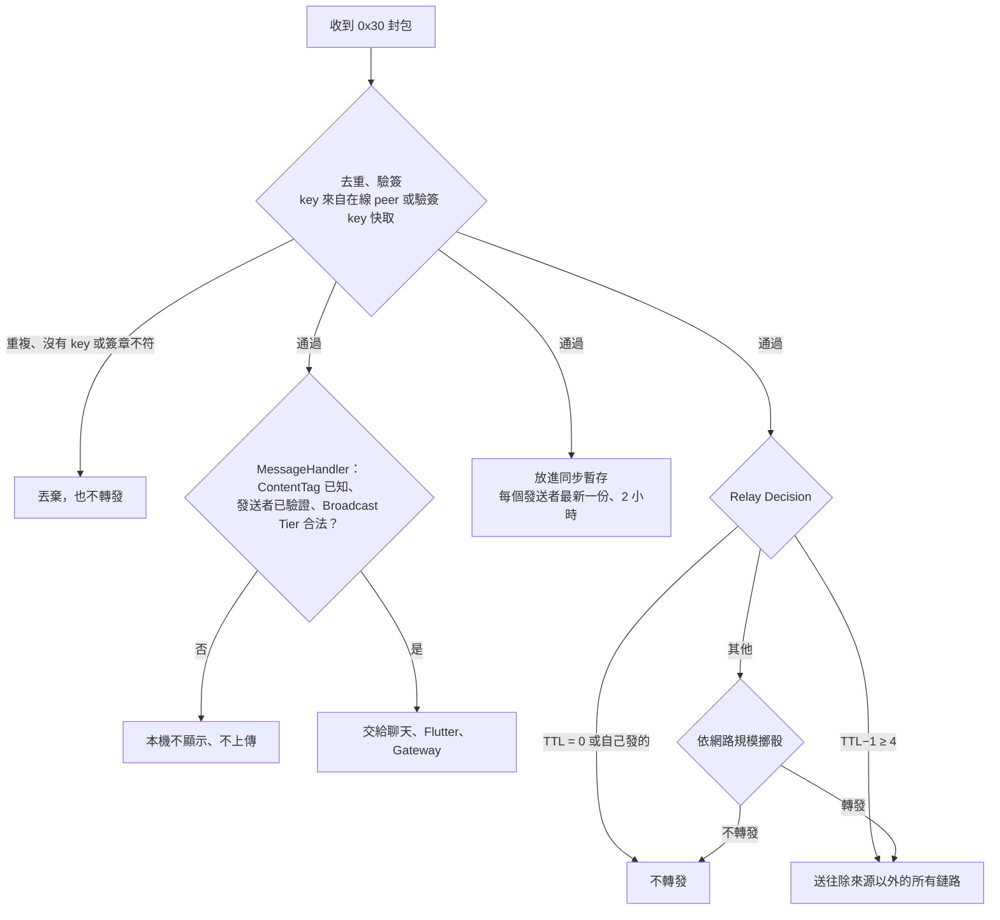

# Health Report 封包與路由機制的修改整理

> 專題總審報告素材，整理於 2026-11-22。
>
> **範圍**：`HEALTH_REPORT`（0x30）封包的格式、送出端、中繼（Relay Decision）、anti-entropy 同步、把回報帶出 mesh 的 Gateway，以及直接決定回報送不送得到的連線層修正。不含 Flutter 畫面、Firestore 的 Detail／Sensitive Tier 與 Mutual-aid Task 的介面邏輯。
>
> **詞彙**依 [CONTEXT.md](../../CONTEXT.md)，領域詞保留原文：Health Report、Reporter、Rescuer、SOS、Status、Severity、Relay Decision、Broadcast Tier、Gateway、Reporter Handle。**Status** 是 Reporter 自己宣告的傷勢；**Severity** 是封包標頭裡給中繼看的繞送提示（ADR-0002）。兩者不可都叫「嚴重度」。

## 0. 資料狀態

每一項都附 commit、ADR 與 issue，方便回頭查證。狀態欄的意思：

| 標記 | 意思 |
|---|---|
| main | 已合併進 `main` |
| 分支 | 整理時在 `fix/four-phone-trial-followups`，尚未合併 |
| 待驗 | 單元測試通過，但還沒在實機上驗證 |

- 本分支的兩份 ADR 原本編為 0010、0011，因為 `main` 已有同號的 ADR（互救任務不合併、Admin Notice），改號為 ADR-0012（SOS 重發）與 ADR-0013（連線策略）。較早的 commit 訊息裡仍是舊編號。
- 第 5、6 節有幾個數字引自「BLE mesh 網路機制概覽」（`docs/BLE_MESH_MECHANISMS.md`）。這份文件只在 `docs/experiment-field-records` 分支上。

---

## 1. 摘要

1. **格式**：從約 150 bytes、含姓名、電話、血型與公尺級座標的明文，改為 ≤ 20 bytes 的 **Broadcast Tier**，不含任何可識別個人的欄位（ADR-0003、ADR-0008）。隱私修正同時縮小了封包。
2. **SOS 併入 Health Report**：SOS 成為 payload 上的一個旗標，不是另一種封包（ADR-0004）。撤回 SOS 就是送一份不帶旗標的新回報。
3. **送達從一層變成三層**：原本只有即時 flood（TTL 3）。現在加上：
   - anti-entropy 同步：一跳一跳補送，不受 TTL 限制，每份保留 2 小時；
   - Reporter 的裝置重發仍舉著 SOS 或受傷的回報（本分支）；
   - Reporter 自己最新的回報跨 app 重啟保存（本分支）。
4. **驗簽與「對方在不在線」脫鉤**：Reporter 離開後，補送的回報仍驗得過簽。驗簽需要的 ANNOUNCE 隨回報逐跳傳下去，下一跳自己驗，不必相信中繼（ADR-0006）。
5. **回報可以離開 mesh**：有網路的手機當 Gateway，把驗證過的 Broadcast Tier 寫進 Firestore（ADR-0009）。
6. **連線層修正**：四機試跑的漏收中，扣掉實驗設計造成的部分，86% 來自 app 的連線管理缺陷，鏈路本身只占 3.4%。據此修了藍牙關／開恢復、殭屍連線，並放寬連線門檻（本分支，ADR-0013）。
7. **Relay Decision 參數化，Severity 尚未啟用**：
   - 「TTL ≥ 4 一律轉發」的門檻改由建構子注入（#1 R13），為模擬器與 Severity-aware Relay 鋪路。
   - Severity 欄位在線路格式上已有槽位，但目前沒有程式設定或讀取（#2）。

---

## 2. 時間軸

| 日期 | 變更 | Commit | 依據 | 狀態 |
|---|---|---|---|---|
| 2026-03-16 | 新增 `DISASTER_REPORT`（0x30，後改名 `HEALTH_REPORT`）封包與 payload；封包標頭加上 Severity 欄位（`HAS_SEVERITY` 旗標 0x10），之後一直沒有使用 | `9c1139a5` | — | main |
| 2026-03-30 | Flutter → Kotlin 的送出路徑；TTL 寫死為 3 | `f889464c` | — | main |
| 2026-04-11 | 端到端可廣播，並在 Flutter 顯示 | `0a51aa5a` | — | main |
| 2026-05-20 | 引入 `BroadcastContentTag`（`HEALTH_REPORT` = 0x01），沒有 tag 的舊格式退回舊解碼 | `4e1be0ae` | — | main |
| 2026-07-31 | 建立 CONTEXT.md、ADR-0001～0003 與改善計畫（R3、R5、R12、R13） | `d9519dc7` | [PLAN.md](../PLAN.md) | main |
| 2026-08-28 | Broadcast Tier v1：≤ 18 bytes，移除 PII | `86fe4ee0` | ADR-0003（R3-A1） | main |
| 2026-09-18 | 移除從未真正上傳過的 `PacketUplinkManager` | `1949fdcb` | — | main |
| 2026-09-20 | 接收端強制驗簽，只收已驗證 peer 的 Health Report；senderID 改用 `myPeerID` | `131a8bf4`、`832d42b2` | — | main |
| 2026-10-04 | 送出路徑抽成 `HealthReportBroadcast`，bridge 與實驗發送器共用 | `c9419c9a` | #70 | main |
| 2026-10-16 | 未知 ContentTag 一律丟棄，拿掉舊格式退回 | `089bed43` | #11 | main |
| 2026-10-18 | Health Report 納入 anti-entropy 同步 | `88e8a965` | #91 | main |
| 2026-10-19 | 實驗 log 的 `SYNC` 事件；驗簽 key 快取；ANNOUNCE 隨回報逐跳傳送 | `7a398861`、`5a6bd8a3`、`04b03baa`、`e2aa1773` | #95、ADR-0006 | main |
| 2026-10-22 | SOS 成為 payload 旗標，payload 升為 v2 | `7cf0a869` | ADR-0004、#81–#83 | main |
| 2026-10-26 | geohash 精度 5 → 6 | `6edd700f` | ADR-0008、#108 | main |
| 2026-10-26 | Gateway：即時上傳、離線暫存、設定開關 | `9a165f9b`、`f02d91bf`、`2dd2ad25`、`ad76d9c4`、`3e663a47` | ADR-0009、#111、#112 | main |
| 2026-11-06 | Flutter 端的送出規則合一（`HealthReportPublisher`） | `abfd67bd` | PR #129 | `origin/main` |
| 2026-11-18 | 四機實地試跑 | — | [試跑報告](../experiment/results/2026-11-18_four-phone-trial.md) | — |
| 2026-11-21 | P0-1～P0-3：藍牙關／開恢復、殭屍連線偵測、保存自己最新的回報 | `12684fca`、`6c17aff1`、`89314845` | 試跑 §13.2 | 分支、待驗 |
| 2026-11-21 | P1-4：成立中的回報每 30 分鐘重發 | `82c01127`、`c9b7317f` | ADR-0012 | 分支、待驗 |
| 2026-11-21 | P1-5、P1-6：連線門檻、背景掃描與廣播 | `89ad4b6a`、`52d0ef09`、`76170b1d` | ADR-0013 | 分支、待驗 |
| 2026-11-21 | P1-7：TTL 門檻參數化；Health Report 的 TTL 改為具名常數 | `365f2529`、`518272f0` | #1 R13、#14 | 分支 |

---

## 3. 封包格式

### 3.1 外層：沿用 bitchat 封包，與 iOS 相容

Health Report 走 bitchat 原有的 `BitchatPacket`，只新增一個訊息類型，外層格式沒有改：

```
header        version 1 | type 0x30 | TTL 1 | timestamp 8 | flags 1 | payloadLength 2   (14 bytes)
senderID      8 bytes，發送裝置的 peerID
payload       ContentTag 0x01 (1 byte) + Broadcast Tier (≤ 20 bytes)
signature     64 bytes，Ed25519；計算時 TTL 以 0 代入，中繼可以改 TTL，改不了其他欄位
```

- 試跑時的實際大小：不帶 geohash 的實驗封包是 101 bytes，帶 geohash-6 時推算為 107 bytes。遠小於 512 bytes 的分片門檻，所以 Health Report 不會被分片，不受「分片逐片擲骰」影響（機制概覽第 1 節）。
- `ContentTag` 的作用是讓同一個 0x30 類型將來能承載不同結構的內容。`MessageHandler.handleTaggedBroadcast()` 會在交給 Flutter 前剝掉它。
  - 2026-05 引入時，沒有 tag 的封包會退回舊解碼。
  - 2026-10（#11）改為未知或缺少 tag 一律丟棄。否則一個新 tag 是否被誤當成 Health Report，只取決於第一個 byte 剛好不是合法的 payload 版本。

### 3.2 Payload 的演進

| 版本 | 內容 | 大小 | 依據 |
|---|---|---|---|
| 原始（2026-03～08） | reporterId、姓名、電話、血型、Status 中文字串、自由文字、經緯度（double）、ISO-8601 時間字串；明文，沒有版本位元組 | 約 150 bytes | — |
| v1（2026-08） | 版本位元組、6-byte Reporter Handle、Status enum、geohash-5、Unix 秒 | ≤ 18 bytes | ADR-0003 |
| v2（2026-10-22） | 加 flags byte（bit0 = SOS）；Status 多一個值「未宣告」 | ≤ 19 bytes | ADR-0004 |
| v2 + geohash-6（2026-10-26） | geohash 精度 5 → 6，版本不變 | ≤ 20 bytes | ADR-0008 |

### 3.3 現行的 Broadcast Tier（v2）

| 位置 | 欄位 | 大小 | 說明 |
|---|---|---|---|
| 0 | version | 1 | 目前為 2；版本 1 仍可解碼，視為沒有 SOS |
| 1–6 | reporterHandle | 6 | 隨機產生，不可由帳號、電話、姓名反推 |
| 7 | status | 1 | 0 安全、1 輕傷、2 重傷、3 未宣告（`HealthStatus` 是唯一的對照表） |
| 8 | flags | 1 | bit0 = SOS；其他位元送出填 0、接收忽略 |
| 9 | geohashLen | 1 | 只能是 0 或 6 |
| 10–15 | geohash | 0 或 6 | ASCII base32；geohash-6 在台灣約 0.6 × 1.1 km，對應村里層級 |
| 末 4 | reportTime | 4 | Unix 秒，Reporter 做出這個陳述的時間 |

**解碼端一律拒收、不做盡力解析**：未知版本、geohash 長度不是 0 或 6、「未宣告」沒帶 SOS、「安全」帶了 SOS。

**單一真相來源**：Kotlin（`DisasterReportTest`）與 Dart（`health_report_payload_test.dart`）讀同一組權威向量，任一端格式走樣，測試就會失敗（PLAN R6）。

### 3.4 格式變更的相容性代價

- v1 → v2、geohash 5 → 6 之後，新舊版裝置互相解不開對方的**所有** Health Report：不顯示、不上傳。
  - 簽章正確的封包仍會照常轉發與同步，因為 Relay Decision 不讀 payload（5.1 節）。
  - 原型階段所有裝置一起更新，可以接受；實機實驗期間不能混用版本。
- 外層 bitchat 格式完全沒改，iOS bitchat 節點照樣能轉發 0x30 封包。

### 3.5 Severity 欄位：有槽位，尚未使用

- 2026-03 起，`BitchatPacket.severity` 就有編解碼（`HAS_SEVERITY` = 0x10），但沒有任何程式設定或讀取。
- ADR-0002 規定：Severity 由送出端從 Status 推導，中繼只看到一個數字。
  - 代價：標頭不加密，範圍內的人都讀得到粗略的緊急程度，約 1.5 bits。
- 2026-11-21 決定 P1-7 時選擇**不改線上格式**，Severity 欄位繼續不用。
  - Severity-aware Relay 留到 #2（F1 加權轉發機率 × F2 優先佇列）再做。
  - SOS 要不要納入 Severity 的推導，也留到那時決定（ADR-0004）。

---

## 4. 送出端

### 4.1 單一送出路徑

- **Kotlin**：`HealthReportBroadcast`（2026-10-04）負責封包組成，bridge 的 `sendHealthReport`、實驗發送器、SOS 重發器共用。只有實驗發送器能覆寫 TTL。
- **Flutter**（`origin/main`，PR #129）：Health 畫面與 SOS 畫面都改呼叫 `HealthReportPublisher`。
  - 原本兩個畫面各寫一份送出流程，已經分歧出 bug：從調查表舉起 SOS 時，任務不會重開。
- **senderID 修正**（2026-09-20）：原本用 Noise 靜態公鑰的前綴當 senderID，與 mesh 的 peerID 不一致，導致「自己的封包不轉發」與 relay 的判斷都失效。改為 `myPeerID`。

### 4.2 TTL 為什麼是 3（#14，`518272f0`）

TTL 3 原本是沒有說明的寫死值（2026-03）。試跑後改為具名常數 `AppConstants.HEALTH_REPORT_TTL_HOPS`，並把理由寫在常數的 KDoc 裡：

1. **TTL 只決定快的那條路，不決定到不到。**
   - 同步會把回報一跳一跳帶到 TTL 範圍外（第 6 節）。
   - TTL 決定的是「幾跳內能在約 1 秒內收到」。所以 TTL 也不能拿來當隱私半徑。
2. **TTL ≤ 4 才能讓每一跳都保有轉發衰減。**
   - 中繼先把 TTL 減 1；減完仍 ≥ 4 的封包一律轉發，跳過依網路規模的轉發機率（5.3 節）。
   - TTL 3 第一次轉發就降到 2，每一跳都走機率；TTL 7 會讓前 3 代轉發一律送出。
   - `HealthReportBroadcastTest` 鎖住這兩個常數的關係，只改其中一個測試就會失敗。

| TTL | flood 最遠 | 直線距離上限 \* | 最後一跳 p50 \* | 每一跳都有轉發衰減 |
|---|---|---|---|---|
| 3（現行） | 4 跳 | ≈ 560 m | ≈ 0.22 s | 是 |
| 4 | 5 跳 | ≈ 700 m | ≈ 0.27 s | 是（能保有衰減的上限） |
| 7（一般封包） | 8 跳 | ≈ 1120 m | ≈ 0.42 s | 否：前 3 代一律轉發 |

\* 以試跑的單跳可靠距離 140 m、每跳 +50 ms 外推；試跑最多只量到 3 跳。

SOS 暫時不另設 TTL，等 E1-C（7 機比較 TTL 3 與 7）與模擬的結果再決定。

### 4.3 保存 Reporter 自己最新的回報（P0-3，`89314845`，分支）

- **問題**（試跑 §7.1）：
  - C 在連線已經失效時送出回報，沒有人收到。
  - 之後 app 重啟，同步暫存被清空，這筆就永遠補不回來。
  - 同步只能補「有人持有」的回報，持有者自己弄丟了，就沒有人能補。
- **做法**：
  - `OwnHealthReportKeeper` 把自己最新一筆**已簽章的封包原樣**加密存在本機。
  - app 啟動時，若封包未過期，就放回 `GossipSyncManager`，之後連上的鄰居經同步補到。
- **刻意的限制**：
  - 放回的是同一個封包，封包 ID、簽章、時間戳都不變，所以仍從原始時間起算 2 小時到期。
  - panic 清除身分時一併刪除；停止服務不刪。

### 4.4 成立中的回報定期重發（P1-4，ADR-0012，`c9b7317f`，分支）

- **問題**：
  - 同步暫存的保存期限從封包時間戳起算。時間戳在簽章範圍內，補送無法延長，所以整個網路對同一筆回報的到期時間相同。
  - SOS 依定義會一直舉著，但 Reporter 若沒再操作手機，2 小時後他的回報就從所有手機上消失。
  - 最需要救援的人，正是最可能無法再操作手機的人。
- **做法**：
  - 最新一筆舉著 SOS，或 Status 為輕傷、重傷時，`MeshForegroundService` 每 30 分鐘以**新的時間戳重新簽章**發送一次。
  - 每次照常以 TTL 3 flood，並進入同步暫存。
- **payload 原封不動**：`reportTime` 與位置都不更新，Rescuer 看到的仍是 Reporter 實際做出陳述的時間。
- **排程**：
  - 下一次排在「上一次的封包時間戳 + 30 分鐘」，重啟不會連發，也不會漏掉。
  - mesh 沒在跑而送不出去時，每 5 分鐘再試一次。
  - 不依賴 Flutter 畫面，app 介面關掉也會重發。
- **停止條件**：最新一筆是「安全」且沒有 SOS，或 panic 清除。實驗 Handle 的回報不重發。
- **否決的方案**：依 Severity 延長保存期限。
  - 只有更新過的 Android 節點會照新期限保存；舊版與 iOS 節點仍 2 小時就丟，補送鏈在它們那裡斷掉。
  - 偽造或過時的 SOS 也會留得一樣久。

---

## 5. 中繼：驗證與 Relay Decision

### 5.1 處理流程



- 去重與驗簽是唯一的閘門。通過之後，上層處理、同步暫存、Relay Decision 三者各自進行（`PacketProcessor`、`BluetoothMeshService`）。
- **Relay Decision 不讀 payload**：中繼不解碼 Broadcast Tier，也不知道 Status，只看 TTL 與網路規模，符合 ADR-0002「relay 程式碼永遠不知道那代表什麼傷勢」。
  - 所以 ContentTag 未知、或 Broadcast Tier 解不開的 0x30 封包，只要簽章正確，仍會照規則轉發並進入同步，只是本機不顯示。
  - 舊版節點因此照樣能轉發新格式的回報。

### 5.2 先驗簽再轉發

- 2026-09-20 起，`HEALTH_REPORT` 列入必須驗簽的類型，沒有簽章就拒收；`MessageHandler` 另外只收已驗證 peer 的 Health Report。
  - 在那之前，沒有簽章的 HEALTH_REPORT 也會被接受。
- 先驗簽、後寫入去重表：反過來的話，攻擊者先送一個偽造封包佔住 ID，之後真正的封包就會被當成重複丟掉。
- 補送的回報需要的驗簽 key 見 6.3 節。

### 5.3 Relay Decision 規則

規則繼承自上游 bitchat，本專題沒有改變行為：

| 條件（依序判斷） | 轉發機率 |
|---|---|
| TTL 減 1 後仍 ≥ 4（`RelayPolicy.unconditionalRelayTtl`） | 100% |
| 網路規模 ≤ 10 | 100% |
| 11–30 | 85% |
| 31–50 | 70% |
| 51–100 | 55% |
| > 100 | 40% |

- 決定轉發後，送往**所有**直連鏈路，只排除封包進來的那條，以及通往原始發送者的那條。沒有 fanout subset，也沒有 jitter。
- 「網路規模」是全網在線的已知節點數，不是本地鄰居數。災區常見的一字排開拓撲，會因此用到偏低的轉發機率（機制概覽第 1 節的討論點）。
- 實機規模（≤ 10 支）一律 100% 轉發，等同 flooding。所以 relay 策略的比較只能靠模擬（ADR-0001，提議中）。

### 5.4 Relay Decision 參數化（#1 R13，`365f2529`，分支）

- 新增 `RelayPolicy`，由 `PacketRelayManager` 的建構子注入；同時注入亂數來源，讓模擬可以用固定 seed 重現。
- 預設值等於現行行為，production 不傳，實機行為不變。
- 這是模擬器（R12）的前置工作：模擬器要串接多個真實的 `PacketRelayManager`，並換掉門檻。
  - 例如門檻設成 255，就是每一跳都走機率。
- 模擬器本身尚未建立。

### 5.5 尚未做：Severity-aware Relay（#2）

改善計畫的核心論點是：「Severity-aware Relay 能讓緊急 Health Report 在壅塞的 mesh 中送達，且對一般流量的代價可接受。」設計是 2×2 因子實驗：

- **F1**：依 Severity 加權轉發機率。單獨施行會增加總負載。
- **F2**：依 Severity 排序的送出佇列。`mesh/` 目前沒有送出佇列。
- **F4**：Severity Inflation 的比例，當作實驗軸量測，不試圖防止。

目前完成的只有前置的 R13。

---

## 6. Anti-entropy 同步：把回報帶出 TTL 範圍

### 6.1 原本的缺口

- 上游 bitchat 的同步只處理 ANNOUNCE 與公開 MESSAGE，交給它的 `HEALTH_REPORT` 都被擋掉。
- 所以沒有鏈路時送出的回報，重新連上後永遠補不回來。

### 6.2 Health Report 納入同步（#91，`88e8a965`）

| 項目 | 設計 |
|---|---|
| 保留什麼 | 每個發送者只留時間戳最新的一份 broadcast Health Report：Rescuer 只依最新的狀態行動 |
| 怎麼比對 | 每 30 秒、新鄰居連上 1 秒後，送出 GCS filter（256 bytes、誤判率 1%）；對方回送缺少的 |
| 怎麼回送 | **原封不動**的已簽章封包，TTL 改為 0：簽章仍有效，而且只給直連鄰居、不再轉發 |
| 保存多久 | 從封包時間戳起 2 小時（`HEALTH_REPORT_RETENTION_MS`），**與 ANNOUNCE 脫鉤**：Reporter 的手機沒電、離開範圍，正是最需要補送的時候 |
| Wi-Fi Aware | `MeshCore` 收到的 Health Report 也交給同步層 |

### 6.3 驗簽 key 與在線 peer 脫鉤（#95，ADR-0006）

- **問題**：
  - 接收端原本只用在線 peer 的 key 驗簽，而 Reporter 3 分鐘沒消息就被移出 peer 列表，key 也跟著消失。
  - 結果是補送的回報送得到，卻沒有人收得下。
- **驗簽 key 快取**（`5a6bd8a3`）：
  - 每份驗證過的 ANNOUNCE 都把公鑰記下：只放記憶體、2 小時、上限 1000 筆，panic 時清除。
  - **只用於驗 Health Report**，不用於 peer 列表、私訊或 Noise 握手，因為那些都隱含「對方此刻在附近」。
- **過舊的 ANNOUNCE 只拿來學 key**：
  - 超過 10 分鐘時間差、但簽章與身分綁定都正確的 ANNOUNCE（最舊 2 小時 10 分），只寫入快取。
  - 經同步送來、超過 3 分鐘的 ANNOUNCE 也一樣。
  - 這兩種都不建立 peer、不轉發，避免早已離開的 Reporter 被重新顯示為在線。
- **ANNOUNCE 隨回報逐跳傳下去**（`04b03baa`、`e2aa1773`）：
  - 中繼持有某人的回報期間，也保留他的 ANNOUNCE，並在回報之前送出。
  - 送出的是 Reporter 自己簽章的 ANNOUNCE，下一跳自行驗證，不必相信中繼。
  - 補送因此可以走多跳：A → B → C → E，E 從沒見過 A 也驗得過。
- **否決的方案**：
  - Health Report 自帶公鑰：每份多 64 bytes，要升 payload 版本。
  - 自我認證的 Reporter Handle：驗證最強，但要改寫 Handle 的定義，留待與隱私問題一起規劃。

### 6.4 時鐘（P1-4 一併處理，分支）

- 各機用自己的時鐘判斷到期。
  - 時鐘快了幾小時的手機，它的回報會在別人的暫存裡多留幾小時。
  - 它又會是該 Reporter「最新的一份」，蓋住他之後真正的回報。
- 同步暫存拒收時間戳比本機時鐘快超過 10 分鐘的 Health Report（`HEALTH_REPORT_MAX_FUTURE_SKEW_MS`）。任何回報最多留 2 小時 10 分。
- 這個檢查**只在同步暫存**，接收與轉發不檢查：在接收端丟掉，等於因為手機時鐘錯了，就不顯示一個真實的 SOS。
- 試跑量到四支手機之間最多差 1.3 s。

### 6.5 接收端如何認出「同一則陳述」

重發與補送都會讓同一份 payload 以不同的封包到達。各層都以 **（Reporter Handle、`reportTime`）** 判斷新舊：

| 位置 | 規則 |
|---|---|
| `GossipSyncManager` | 每個發送者只留時間戳最新的封包 |
| `MessageHandler`（`HealthReportRepeatFilter`，分支） | 同一則陳述只交給聊天一次，避免重發時每 30 分鐘震動一次；晚到的舊回報不算新的 |
| Flutter Health 畫面、Mutual-aid Task（`mergeBleReport`、`MutualAidTaskBoard`） | 每個 Handle 一筆，依 `reportTime` 只留最新的，晚到的舊回報不會蓋掉新的；只有 `reportTime` 較新時才套用任務的重開規則，重發不會讓已完成的任務重開 |
| Gateway（`MeshGateway`） | `reportTime` 比該 Handle 已上傳的新才上傳 |

### 6.6 三層送達的比較

| 機制 | 誰送 | 範圍 | 延遲 | 回報存活多久 |
|---|---|---|---|---|
| 即時 flood | Reporter 與中繼 | TTL 3，最遠 4 跳，每跳依網路規模擲骰 | 每跳約 +50 ms（試跑中位數） | 只在送出當下 |
| anti-entropy 同步 | 每一跳的鄰居 | 不受 TTL 限制，一跳一跳往外 | 新連線約 1 s；已連著的鏈路每跳最多 30 s | 從封包時間戳起 2 小時 |
| 保存自己的回報（分支） | Reporter 的裝置 | app 重啟後重新提供給同步 | 下一個鄰居連上時 | 同一封包，到期時間不變 |
| 成立中的回報重發（分支） | Reporter 的裝置 | 同 flood，並重新進入同步 | 每 30 分鐘 | 只要 SOS 或受傷仍成立就延續 |

---

## 7. 離開 mesh：Gateway（ADR-0009）

依 CONTEXT.md：relay 把封包送往 mesh；Gateway 把封包送出 mesh，寫進後端。

- **掛載點**：`MessageHandler` 通過驗證、解碼成功、確認不是實驗 Handle 之後，經 `VerifiedHealthReportBridge` 交出三樣東西：原始封包、解碼後的 payload、發送者 peerID。
  - 即時 flood 與同步補送都走這條路。
  - `mesh/` 不依賴 Firebase。
- **上傳條件**：已登入、網路已驗證可用、回報不超過 2 小時、`reportTime` 比這個 Handle 已上傳的新。
- **寫入內容**：寫進 `mesh_reports/{reporterHandle}`。
  - 只有 Broadcast Tier，不加密、不帶 Detail Tier。
  - 附上原始簽章封包與 Reporter 的 ANNOUNCE，日後後端要補驗簽，不必改 App。
- **離線暫存**：每個 Handle 只留最新一份，上限 1000 筆，**只放記憶體**。網路恢復、使用者登入時補傳。換帳號登入時清空，避免前一個帳號在場時收到的回報記到新帳號頭上。
- **在 Kotlin 端執行**：在 `MeshForegroundService` 的生命週期內，畫面關掉也照樣代傳。這是「Kotlin 端不使用 Firebase」的有意破例。
- **使用者控制**：設定頁「代傳附近的求救與回報」，預設開啟，可以關掉，並附隱私揭露。
- **權限**：`mesh_reports` 只有 Administrator 讀得到。

---

## 8. 連線層：路由的前提（分支，ADR-0013）

路由的前提是有鏈路。四機試跑顯示，決定 Rescuer 能不能及時收到 Health Report 的，是「連不連得上」，不是鏈路品質。

| 項目 | 試跑看到的問題 | 修改 | Commit |
|---|---|---|---|
| P0-1 藍牙關／開恢復 | D 關藍牙後，連線表留著 A、B 的殘留連線 28 分鐘，重開後因此不連 A、B；寫入舊 GATT 物件失敗約 13.3 萬次；3 分 52 秒才經 C 重新入網 | 監聽 `ACTION_STATE_CHANGED`：關閉時清空連線表、停止 GATT 呼叫；開啟時重建 GATT、掃描與廣播；`DeadObjectException` 視同藍牙重啟 | `12684fca` |
| P0-2 殭屍連線 | C 掛著 2–3 條連線 20 分鐘，一筆都沒收到，占非設計漏收的最大宗 | 一條鏈路 90 s 沒收到封包就在本機斷開重連；每 15 s 檢查；以不含深度睡眠的單調時鐘計 | `6c17aff1` |
| P1-5 連線門檻 | 連線撐到約 170 m，重新連上卻要走回約 15 m：雙方早在 −84～−106 dBm 就互相掃到，app 因 −85 dBm 門檻不連 | 孤立（直連 peer 少於 2 個）時 −115 dBm，聽得到就連；名額快滿時維持上游的嚴格門檻；弱候選 10 s 逾時與退避；名額滿時以強換弱（強 10 dB 以上）；淘汰時先淘汰最弱的 | `89ad4b6a` |
| P1-6 背景 | 背景、沒有直連時每 60 s 只掃 1 s，又用低功耗掃描；B 沒有啟動前景服務，使用者也不知道 | 背景、沒有直連時每 30 s 掃 4 s，改用 BALANCED；沒有直連時提高廣播功率；前景服務沒在跑時，首頁顯示原因與一鍵修正 | `52d0ef09` |

- 全部不改封包格式，與 iOS 相容。
- 所有數字都是具名常數，實驗後可以直接調整。

---

## 9. 實驗證據

### 9.1 2026-11-18 四機試跑（[報告](../experiment/results/2026-11-18_four-phone-trial.md)）

測試時用的是修改前的版本：TTL 3，A 以 1 Hz 送出 1924 筆 Health Report。

| 指標 | 數值 | 出處 |
|---|---|---|
| 單跳最大距離／可靠距離 | 170 m／140 m | §5 |
| 重新連上的距離 | 約 15 m（連線門檻造成） | §8 |
| 範圍邊緣的雙跳 PDR | B 96.9%，C 經 B 96.9%，B→C 一跳沒掉 | §6 |
| 延遲 | 1 跳 p50 68 ms、p95 136 ms；2 跳 p50 118 ms、p95 566 ms；每跳中位數 +50 ms | §11.1 |
| 同步送達 | 重新連上後約 1.1–1.2 s 收到，收到時 TTL 0；每位發送者只補最新一筆 | §7.1 |
| Reporter 不在範圍後的驗簽 | D 關藍牙 19 分鐘後重新入網，仍驗得過 B 經同步補送的回報 | §7.1 |
| Flooding 成本 | 每筆全網送出 2.41 次，鏈路層寫出 4.81 次；每節點每筆收到 1.6–3.1 份；佇列滿（QFULL）0 次 | §11.2 |
| 直連數 | `n_links` 最多 6 條，不重複的鄰居最多 3 個：同一對手機常有兩條連線 | §11.2 |

### 9.2 漏收歸因（§13.1）

3 個接收端 × 1924 筆 = 5772 筆應收，漏收 3064 筆。扣掉實驗設計造成的 1942 筆（D 關藍牙、A 走出所有人的範圍），剩下的 1122 筆：

| 原因 | 筆數 | 占比 | 對應修改 |
|---|---|---|---|
| app 缺陷（殭屍連線、藍牙恢復、殘留連線） | 966 | 86% | P0-1、P0-2 |
| 連線門檻 | 118 | 10.5% | P1-5 |
| 鏈路本身 | 38 | 3.4% | — |

**可寫進報告的觀察**：

- 實機規模內觀察不到壅塞：每筆都被轉發，佇列從未滿過。
- 漏收幾乎都來自連線管理，不是 relay 策略。
- 所以 Severity-aware Relay 的效益只能靠模擬回答；實機數據先回答「稀疏網路裡回報送不送得到」。

### 9.3 尚未在實機上驗證

| 實驗 | 要確認的事 | 對應修改 |
|---|---|---|
| E5-D | 藍牙重開後幾秒內與 A、B 重建連線；殭屍連線能恢復；Reporter 離開後，從沒見過他的人經補送收到並驗過簽（#91 AC2、AC4；#95 的 D2）；Rescuer 在 SOS 送出 2 小時後才入網仍收得到 | P0-1、P0-2、P0-3、P1-4、#91、#95 |
| E5-C | −115 與舊的 −85 dBm 下，Rescuer 走進來多遠會連上（前景、背景各一次） | P1-5、P1-6 |
| E4 | 0、2、4 條連線的每小時耗電；背景較長的掃描與較強的廣播多耗多少電；安靜但正常的連線會不會被誤斷 | P0-2、P1-5、P1-6 |
| E3 | 人多時名額會不會被弱連線塞滿、會不會反覆替換 | P1-5 |
| E1-C | 7 機線性鏈，比較 TTL 3 與 7 的可達跳數、PDR(h) 與傳輸成本 | TTL（#14）、SOS 是否另設 TTL |

---

## 10. 已知限制與取捨

適合放進報告的「限制」章節。

| 限制 | 說明 | 出處 |
|---|---|---|
| 信任程度等同 TOFU | 對從沒見過 Reporter 的接收端，經中繼帶來的 ANNOUNCE 無法驗證 signing key 與 Noise 公鑰的綁定 | ADR-0006 |
| Handle 可被連到暱稱 | Health Report 的 senderID 就是裝置的 peerID；ANNOUNCE 帶著暱稱，隨回報傳得更遠、留得更久；重發讓曝光時間延長 | ADR-0006、ADR-0012 |
| Severity 可被讀到、可被灌水 | 標頭不加密，約 1.5 bits 的緊急程度外洩；Severity Inflation 無法防止，只能量測。重發也一樣：宣告輕傷就能換到持續重發 | ADR-0002、ADR-0012 |
| 同步請求沒有簽章 | 偽造的 REQUEST_SYNC 可以讓鄰居大量回送封包（安全審查 H11） | 機制概覽第 4 節 |
| 後端不驗簽 | 任何登入帳號都能直接寫 `mesh_reports`，包括用聽到的真實 Handle 寫一份「安全」蓋掉真的 SOS；目前只靠 `gatewayUid` 稽核 | ADR-0009 |
| 2 小時內沒遇到 Gateway 的 SOS 上傳不了 | Gateway 與 `mesh_reports` 規則都以 `reportTime` 判斷 2 小時（規則容忍 130 分鐘），重發不更新 `reportTime` | ADR-0012 |
| 重發間隔會被拉長 | 30 分鐘以 uptime 計，Doze 下會變長；實測接近 2 小時的話，改用 `AlarmManager` | ADR-0012 |
| 重發的位置會過時 | Reporter 移動後，Rescuer 要以 `reportTime` 判斷陳述與位置有多舊 | ADR-0012 |
| 藍牙關閉時 mesh 仍算在執行 | 這時送出的 Health Report 沒有鄰居直接收到，要等連上後經同步補送 | P0-1 |
| 時鐘快超過 10 分鐘的手機 | 回報仍即時 flood，但不進任何同步暫存，晚到的 Rescuer 收不到 | ADR-0012 |
| 版本不相容 | payload 升版本、改 geohash 精度，新舊版裝置都會互相拒收全部 Health Report | ADR-0004、ADR-0008 |
| 每跳補送最多等 30 秒 | 跨多跳的分區重新連上時，回報抵達遠端約需「跳數 × 30 秒」 | 機制概覽第 4 節 |
| iOS 節點 | 能轉發 0x30 封包；iOS 的廣播沒有 service data，不會觸發以強換弱 | ADR-0013 |

---

## 11. 未完成與後續工作

| 項目 | 狀態 |
|---|---|
| #1 政策層模擬平台（R12） | 未建；ADR-0001 仍是提議中。本分支只完成 R13 的參數化 |
| #2 Severity-aware Relay（F1 × F2） | 未開始；Severity 欄位未使用 |
| #91、#95 | 程式已合併 main，issue 保持 open，等實機驗收 |
| #111、#112 Gateway | 程式已合併 main，issue 保持 open |
| #14 TTL 3 寫死 | 本分支已改為具名常數並寫明理由，合併後可關閉 |
| SOS 是否提高 TTL | 等 E1-C 與模擬 |
| 自我認證的 Reporter Handle | 能同時處理 TOFU 與暱稱連結的問題，改動最大，未排程（ADR-0006） |
| 文件同步 | 試跑報告第 13 節已補上實作狀態（13.5）；`MESH_GATEWAY.md` 已對上 SOS 重發。「BLE mesh 網路機制概覽」仍只在 `docs/experiment-field-records` 分支上，要不要併入 main 另行決定 |

---

## 12. 測試

最後一次完整執行（本分支）：Kotlin 單元測試 1324 個，0 失敗、3 個略過；Flutter 測試 697 個全部通過。

| 機制 | 測試 |
|---|---|
| 線路格式、權威向量 | `DisasterReportTest`、`health_report_payload_test.dart`、`HealthReportBridgeMapTest` |
| 送出路徑與 TTL | `HealthReportBroadcastTest` |
| 接收、ContentTag、重複陳述 | `MessageHandlerTest`、`HealthReportChatTimelineTest` |
| 驗簽 | `SecurityManagerTest`、`SecurityManagerHealthReportSigningKeyTest`、`HealthReportSigningKeyCacheTest` |
| Relay Decision | `PacketRelayManagerTest` |
| 同步 | `GossipSyncManagerHealthReportTest` |
| 保存自己的回報 | `OwnHealthReportKeeperTest`、`EncryptedOwnHealthReportStoreTest` |
| 重發 | `StandingReportRebroadcasterTest` |
| Gateway | `MeshGatewayTest`、`MeshGatewayRuntimeTest` |
| 連線層 | `BluetoothRadioRecoveryPolicyTest`、`BluetoothConnectionTrackerIdleLinkTest`、`ConnectionRssiThresholdTest`、`EdgeConnectGuardTest`、`WeakLinkReplacementTest`、`PowerProfileResolverTest` |
| Flutter 端合併與任務重開 | `mutual_aid_tasks_test.dart`、`mutual_aid_task_board_test.dart` |

---

## 附錄：主要程式位置

| 角色 | 檔案 |
|---|---|
| 訊息類型與 ContentTag | [BinaryProtocol.kt](../../app/src/main/java/com/bitchat/android/protocol/BinaryProtocol.kt) |
| Broadcast Tier | [DisasterReportPacket.kt](../../app/src/main/java/com/bitchat/android/protocol/DisasterReportPacket.kt)、[HealthStatus.kt](../../app/src/main/java/com/bitchat/android/protocol/HealthStatus.kt) |
| 送出 | [HealthReportBroadcast.kt](../../app/src/main/java/com/bitchat/android/service/HealthReportBroadcast.kt)、[AppConstants.kt](../../app/src/main/java/com/bitchat/android/util/AppConstants.kt) |
| 接收 | [MessageHandler.kt](../../app/src/main/java/com/bitchat/android/mesh/MessageHandler.kt)、[HealthReportRepeatFilter.kt](../../app/src/main/java/com/bitchat/android/mesh/HealthReportRepeatFilter.kt) |
| 驗簽 | [SecurityManager.kt](../../app/src/main/java/com/bitchat/android/mesh/SecurityManager.kt)、[HealthReportSigningKeyCache.kt](../../app/src/main/java/com/bitchat/android/mesh/HealthReportSigningKeyCache.kt) |
| Relay Decision | [PacketRelayManager.kt](../../app/src/main/java/com/bitchat/android/mesh/PacketRelayManager.kt)、[RelayPolicy.kt](../../app/src/main/java/com/bitchat/android/mesh/RelayPolicy.kt) |
| 同步 | [GossipSyncManager.kt](../../app/src/main/java/com/bitchat/android/sync/GossipSyncManager.kt)、[OwnHealthReportKeeper.kt](../../app/src/main/java/com/bitchat/android/sync/OwnHealthReportKeeper.kt) |
| 重發 | [StandingReportRebroadcaster.kt](../../app/src/main/java/com/bitchat/android/service/StandingReportRebroadcaster.kt) |
| Gateway | [MeshGateway.kt](../../app/src/main/java/com/bitchat/android/gateway/MeshGateway.kt)、[VerifiedHealthReportBridge.kt](../../app/src/main/java/com/bitchat/android/mesh/VerifiedHealthReportBridge.kt)、[MESH_GATEWAY.md](../MESH_GATEWAY.md) |
| ADR | [0002](../adr/0002-severity-is-a-derived-transport-hint.md)、[0003](../adr/0003-tiered-disclosure-for-health-reports.md)、[0004](../adr/0004-sos-is-a-mark-on-health-report.md)、[0006](../adr/0006-health-report-signing-keys-outlive-peers.md)、[0008](../adr/0008-broadcast-tier-geohash-precision-6.md)、[0009](../adr/0009-gateway-uploads-broadcast-tier-from-kotlin.md)、[0012](../adr/0012-standing-sos-is-rebroadcast-by-reporter-device.md)、[0013](../adr/0013-connection-policy-favours-sparse-networks.md) |
